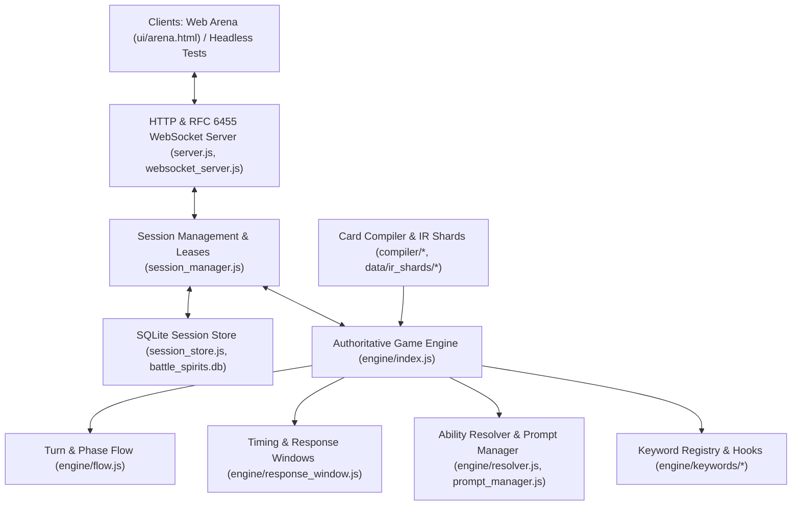

# BATTLE SPIRITS ETERNAL — FULL PROJECT FORENSIC AUDIT
## 01. PROJECT ARCHITECTURE AND INVENTORY

**Project Root:** [c:/Users/namis/Downloads/BSP](file:///c:/Users/namis/Downloads/BSP)  
**Package Version:** 2.0.0 (`"type": "module"`)  
**External Dependencies:** **ZERO** (Strictly pure Node.js built-ins: `node:http`, `node:https`, `node:crypto`, `node:sqlite`, `node:child_process`, `node:test`, `node:assert`)  
**Target Environment:** Node.js v22+ / v24+

---

### 1. Subsystem Architecture Overview

The Battle Spirits Eternal (BSP) architecture is structured around five decoupled architectural tiers:

---

### 2. Comprehensive Directory & File Inventory

#### A. Core Engine Subsystem (`engine/` — 33 modules)
- [engine/index.js](file:///c:/Users/namis/Downloads/BSP/engine/index.js): Primary game factory (`createGame`), public action API (`declareAttack`, `declareBlock`, `playCard`, `advanceStep`), and top-level lifecycle coordination.
- [engine/flow.js](file:///c:/Users/namis/Downloads/BSP/engine/flow.js): Turn phase state machine (Start, Core, Draw, Refresh, Main, Attack, End steps).
- [engine/response_window.js](file:///c:/Users/namis/Downloads/BSP/engine/response_window.js): Authoritative timing window manager (`TimingWindowManager`, `ResponseWindowManager`). Manages `FLASH_1`, `BLOCK_DECLARATION`, `FLASH_2`, `BURST`, priority alternation, and candidate calculation.
- [engine/flash_timing.js](file:///c:/Users/namis/Downloads/BSP/engine/flash_timing.js): Canonical rules validator for Flash timing conditions, step restrictions, and combat clash requirements.
- [engine/session_manager.js](file:///c:/Users/namis/Downloads/BSP/engine/session_manager.js): Multi-tenant battle match manager (`BattleSessionManager`), action authority verification, connection leases, turn clock management, and snapshot persistence.
- [engine/session_store.js](file:///c:/Users/namis/Downloads/BSP/engine/session_store.js): SQLite database wrapper (`SessionStore`) using `node:sqlite`. Manages schemas, sessions, action ledger, event log, and atomic transactions.
- [engine/websocket_server.js](file:///c:/Users/namis/Downloads/BSP/engine/websocket_server.js): RFC 6455 compliant WebSocket server implementation built without external libraries.
- [engine/resolver.js](file:///c:/Users/namis/Downloads/BSP/engine/resolver.js): Asynchronous ability effect execution engine (`AsyncResolver`, `DefaultPromptResolver`).
- [engine/prompt_manager.js](file:///c:/Users/namis/Downloads/BSP/engine/prompt_manager.js): Interactive decision request queue and promise-based resolution coordinator.
- [engine/interaction.js](file:///c:/Users/namis/Downloads/BSP/engine/interaction.js): Candidate selection, validation, and pending interaction tracking.
- [engine/sba.js](file:///c:/Users/namis/Downloads/BSP/engine/sba.js): State-Based Actions (Rule 7). Automatically destroys 0-core units, handles BP comparison destruction, and cleans expired continuous effects.
- [engine/continuous.js](file:///c:/Users/namis/Downloads/BSP/engine/continuous.js): Continuous modifier recalculation (Level determination, BP boosts, symbol modifications, immunity checks).
- [engine/conditions.js](file:///c:/Users/namis/Downloads/BSP/engine/conditions.js): Predicate evaluator for card play, ability activation, and target eligibility.
- [engine/restrictions.js](file:///c:/Users/namis/Downloads/BSP/engine/restrictions.js): Activation limits, once-per-turn locks, and format restrictions.
- [engine/zones.js](file:///c:/Users/namis/Downloads/BSP/engine/zones.js): Atomic zone movement operations (Deck, Hand, Field, Trash, Void, Removed, Mirage, Reserve).
- [engine/state.js](file:///c:/Users/namis/Downloads/BSP/engine/state.js): Initial state construction, card instances, and field stack builders.
- [engine/state_serialization.js](file:///c:/Users/namis/Downloads/BSP/engine/state_serialization.js): JSON state serialization, deserialization, and viewer-specific credential scrubbing.
- [engine/ai.js](file:///c:/Users/namis/Downloads/BSP/engine/ai.js): Heuristic automated AI player for bot matches.

#### B. Compiler Subsystem (`compiler/` — 6 modules)
- [compiler/keyword_compiler.js](file:///c:/Users/namis/Downloads/BSP/compiler/keyword_compiler.js): Keyword extractor and catalog compiler (354 catalog entries).
- [compiler/clause_patterns.js](file:///c:/Users/namis/Downloads/BSP/compiler/clause_patterns.js): 318KB regex pattern repository for Japanese and English card effect compilation.
- [compiler/clause_splitter.js](file:///c:/Users/namis/Downloads/BSP/compiler/clause_splitter.js): Ability clause delimiter parser.
- [compiler/header_parser.js](file:///c:/Users/namis/Downloads/BSP/compiler/header_parser.js): Parses timing brackets, levels, costs, and activation qualifiers.
- [compiler/identity.js](file:///c:/Users/namis/Downloads/BSP/compiler/identity.js): Canonical card identification, numbering, and reprint deduplication.
- [compiler/index.js](file:///c:/Users/namis/Downloads/BSP/compiler/index.js): Compiler facade and batch compilation pipeline.

#### C. Card Database Corpus (`data/`)
- [data/cards_detailed.json](file:///c:/Users/namis/Downloads/BSP/data/cards_detailed.json): 18.19 MB, 14,443 complete card records.
- [data/cards_index.json](file:///c:/Users/namis/Downloads/BSP/data/cards_index.json): 7.58 MB, 14,443 fast lookup index keys.
- [data/card_effects_db.json](file:///c:/Users/namis/Downloads/BSP/data/card_effects_db.json): 348 MB compiled intermediate representation (IR) database.
- [data/rebirth_catalog.json](file:///c:/Users/namis/Downloads/BSP/data/rebirth_catalog.json): 530 dual-faced / Rebirth card definitions.
- [data/keyword_specs/](file:///c:/Users/namis/Downloads/BSP/data/keyword_specs): 348 individual mechanical specification JSON files.
- [data/ir_shards/](file:///c:/Users/namis/Downloads/BSP/data/ir_shards): 514 precompiled IR shards.

#### D. Keyword Registry Subsystem (`engine/keywords/` — 8 files)
- [engine/keywords/index.js](file:///c:/Users/namis/Downloads/BSP/engine/keywords/index.js): Registry bootstrap.
- [engine/keywords/registry.js](file:///c:/Users/namis/Downloads/BSP/engine/keywords/registry.js): `KeywordRegistry` class, hook dispatch, and `attachToGame()`.
- [engine/keywords/wave1.js](file:///c:/Users/namis/Downloads/BSP/engine/keywords/wave1.js): Core Battle Keywords (Clash, Curse, Crush, Holy Life, etc.).
- [engine/keywords/wave2.js](file:///c:/Users/namis/Downloads/BSP/engine/keywords/wave2.js): Modern Keywords (Accel, Mirage, Change, High Speed, Seal, etc.).
- [engine/keywords/wave3.js](file:///c:/Users/namis/Downloads/BSP/engine/keywords/wave3.js): Triggers & Collab (Ultimate Trigger, Brilliance, etc.).
- [engine/keywords/wave4.js](file:///c:/Users/namis/Downloads/BSP/engine/keywords/wave4.js): Advanced Color Keywords (Pursuit, Soar, Bunshin, Ice Wall, Immortality, etc.).
- [engine/keywords/wave5.js](file:///c:/Users/namis/Downloads/BSP/engine/keywords/wave5.js): Diva & Collab Mechanics (On Stage, Clock Up, etc.).
- [engine/keywords/wave6.js](file:///c:/Users/namis/Downloads/BSP/engine/keywords/wave6.js): Cross-Format & 2026 Mechanics (Rumble, Flag Contract Advent, etc.).

#### E. Server & Web Frontend (`server.js`, `ui/`)
- [server.js](file:///c:/Users/namis/Downloads/BSP/server.js): 76KB HTTP server, REST endpoints, SSE stream provider, and static file server.
- [ui/arena.html](file:///c:/Users/namis/Downloads/BSP/ui/arena.html): Interactive visual Battle Spirits arena.
- [ui/deckbuilder.html](file:///c:/Users/namis/Downloads/BSP/ui/deckbuilder.html): Deck construction and validation interface.
- [ui/index.html](file:///c:/Users/namis/Downloads/BSP/ui/index.html): Match lobby and mode selector.

#### F. Test Suites (`tests/` — 261 test files)
- 261 test files directly under `tests/` encompassing 1,846 declared test cases.
- Includes unit tests, security suites, session persistence tests, regression suites, and headless Chrome CDP browser E2E tests.

---

### 3. Runtime Execution & Storage Model

1. **In-Memory Volatile Game Execution:**
   - Every active match is instantiated via `createGame()` and maintained inside `sessionManager.activeGames` Map.
   - Game state mutations are synchronous or asynchronous promise-driven in memory.
2. **Atomic SQLite Persistence:**
   - Database: `battle_spirits.db` (WAL mode enabled via PRAGMA journal_mode = WAL).
   - On every successful player action, `commitActionTransaction` atomically updates session state, increments version, records the action in `match_actions` ledger, and appends the event to `match_events`.
3. **Real-Time Client Synchronization:**
   - Bidirectional WebSocket connections via [engine/websocket_server.js](file:///c:/Users/namis/Downloads/BSP/engine/websocket_server.js).
   - Server-Sent Events (SSE) fallback via `GET /api/sessions/:matchId/stream`.
   - REST polling fallback via `GET /api/sessions/:matchId`.
