# Work Package I — Local Browser Playability Report

**Project:** Battle Spirits Eternal (BSP)  
**Deliverable:** `reports/master_corrective_closure/browser_playability_report.md`  
**Test Suites:** `tests/real_browser_arena.test.js`, `tests/browser_arena_gameplay.test.js`, `tests/phase6_7_ui_routes.test.js`  
**Date:** 2026-11-21  
**Status:** Locally Playable & Independently Verified in Real Chrome  

---

## 1. Executive Summary

Work Package I establishes the end-to-end local browser playability of Battle Spirits Eternal. Both real headless Chrome (via CDP) and mock-DOM integration tests confirm that the web arena (`/arena.html`), static assets, card databases, interaction modals, and production gameplay routines function seamlessly together without state tampering or external dependencies.

---

## 2. Browser Playability Infrastructure

### 2.1 Local Server & Asset Serving
- **Server:** `server.js` starts a lightweight HTTP server supporting dynamic port binding (`PORT: 3800–4600`).
- **Static Assets:** Serves `arena.html`, `browse.html`, `index.html`, `styles.css`, `battle_arena.js`, and card image assets.
- **API Endpoints:** `/api/cards-batch` enables high-performance batched card lookups by card name or number.

### 2.2 Dual-Tier Browser Testing Architecture
1. **Tier 1 — Real Browser Automation (CDP Chrome):**
   - Implemented in `tests/real_browser_arena.test.js` using `tests/helpers/real_browser.js`.
   - Spawns genuine headless Chrome, navigates to `/arena.html`, and drives user clicks and inputs through native WebSocket DevTools Protocol.
   - Result: **10/10 PASS (100% flake-free).**
2. **Tier 2 — Mock-DOM Full-Cycle Integration:**
   - Implemented in `tests/browser_arena_gameplay.test.js`.
   - Simulates complete 16-step gameplay flow within a headless DOM environment.
   - Result: **PASS (16/16 steps verified).**
3. **Tier 3 — UI Routes & Asset Delivery:**
   - Implemented in `tests/phase6_7_ui_routes.test.js`.
   - Confirms route resolution, modal styling, step navigator, and deckbuilder drawer.
   - Result: **10/10 PASS.**

---

## 3. End-to-End User Experience Verified

```mermaid
flowchart LR
    A["Launch arena.html"] --> B["Select Decks & startDuel()"]
    B --> C["Coin Flip & Opening Draw (4 Cards)"]
    C --> D["Advance Phases: START -> CORE -> DRAW -> REFRESH -> MAIN"]
    D --> E["Click Card in Hand -> Open Summon Modal"]
    E --> F["Allocate Cores & Confirm Payment"]
    F --> G["Spirit Appears on Field with Cores"]
    G --> H["Advance to ATTACK Step"]
    H --> I["Click Spirit -> Declare Attack"]
    I --> J["Opponent Life Reduced 5 -> 4"]
```

1. **Board Layout:** Cleanly displays player field, opponent field, reserve core pools, trash pools, life counters, and active Soul Core status.
2. **Summon Modal:** Computes printed cost, applies symbol discounts, displays available reserve cores, and allows placement of normal and Soul cores.
3. **Target Modal:** Renders legal candidate spirits with BP, cost, and name; requires selection within `[min, max]` before enabling confirm button.
4. **Combat Flow:** Attacks exhaust attacking units, play sound effects, prompt defense options, and apply damage cleanly.
