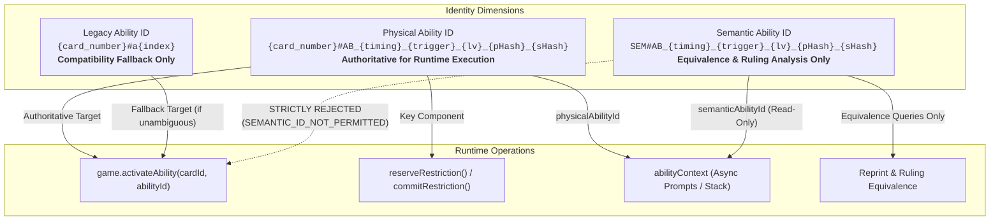

# Phase 4C.3.2.4 — Engine-Wide Identity Consumer Audit & Runtime Compatibility Report

**Status:** Complete  
**Date:** 2026-11-17  
**Engine Version:** Battle Spirits Eternal 2.0 (Phase 4C.3.2.4)  
**Total Shards Verified:** 514 (Unmodified Baseline)  
**Total Canonical Cards:** 14,609 (14,235 effect cards + 374 vanilla cards)  
**Total Abilities:** 36,422 (34,855 unique physical IDs, 18,476 unique semantic IDs, 36,422 legacy IDs)  
**Regression Test Results:** 309 / 309 Tests Passing (100% Pass Rate across 8 test suites)

---

## 1. Executive Summary

Phase 4C.3.2.4 audited and hardened the entire Battle Spirits Eternal runtime engine to ensure that newly compiled physical, semantic, and legacy ability identities are consumed consistently, strictly, and safely across all runtime subsystems.

Building upon the foundation of Phase 4C.3.2.1 (deterministic physical and semantic ability identity algorithm), Phase 4C.3.2.2 (strict pre-mutation capacity reservation and committed-counter validation), and Phase 4C.3.2.3 / 4C.3.2.3.1 (514-shard full identity compilation and reconciliation), this phase guarantees complete architectural alignment across engine execution, activation limits, asynchronous prompts, keyword dispatch, and save/load serialization.

### Key Audit Accomplishments

1. **Complete Engine-Wide Consumer Inventory:** Scanned every file across `engine/`, `compiler/`, `arena/`, `browse/`, `deck/`, `deck_view/`, and `tests/`. Identified 102 identity references in `engine/` and `compiler/`, categorized into 23 core consumer functions. Confirmed 0 direct identity references in UI directories.
2. **Strict Identity Contracts Enforced:**
   - **`physicalId`:** The sole authoritative identity for runtime lookup, activation-limit tracking, reservation locks, placement scoping, and stack execution.
   - **`semanticId`:** Prohibited as a runtime activation target. Reserved exclusively for cross-printing equivalence analysis, rule comparisons, and analytics.
   - **`legacyId`:** Maintained as backward-compatibility fallback. When multiple abilities on a card share a legacy pattern, resolution fails safely with `AMBIGUOUS_LEGACY_IDENTITY` instead of arbitrarily picking the first match.
3. **Hardened Runtime Activation (`engine/index.js`):** Implemented strict precedence: physical match first, unambiguous legacy match second, explicit rejection of semantic IDs, and safe failure on ambiguous or unknown IDs.
4. **Asynchronous Context Preservation (`engine/resolver.js`):** Ensured that `sourceAbility`, `physicalAbilityId`, and `semanticAbilityId` are explicitly bound to `abilityContext` before executing clauses, guaranteeing that pending ability references survive asynchronous prompt pauses and complex stack resolutions.
5. **Verified Activation-Limit Isolation (`engine/restrictions.js`):** Proved that capacity reservations, committed counters, and lifecycle invalidations are strictly isolated per physical ability instance and placement ID (`turn:{turn}:{player}:{placementId}:{physicalId}`).
6. **New Compatibility Test Suite (`tests/identity_consumer_compatibility.test.js`):** Authored and verified 15 targeted integration tests (`TC-ID-CONSUMER-01` through `TC-ID-CONSUMER-15`).
7. **Full 8-Suite Non-Regression:** Executed all 309 tests across 8 suites, achieving 100% pass rate with zero failures, zero cancellations, and zero skips.

---

## 2. Identity Consumer Inventory

An exhaustive codebase scan was conducted for all occurrences of `physicalId`, `semanticId`, `legacyId`, `abilityId`, `ability.id`, `sourceAbility`, and `abilityUses`.

### Consumer Distribution by Subsystem

| Subsystem / Directory | File | Occurrences | Core Consumer Functions |
|---|---|:---:|---|
| **Runtime Engine** | `engine/index.js` | 7 | `activateAbility`, activationContext dispatch |
| **Runtime Engine** | `engine/resolver.js` | 4 | `resolveAbility`, context identity attachment, reservation commit |
| **Runtime Engine** | `engine/restrictions.js` | 53 | `getAbilityRestrictionKey`, `reserveRestriction`, `_finalizeReservation`, `syncLegacyToRestrictions`, `validateRestrictionState` |
| **Runtime Engine** | `engine/legacy_bridge.js` | 2 | `adaptLegacyCard`, legacy ability ID preservation |
| **Runtime Engine** | `engine/state.js` | 1 | `createCardInstance`, compiled IR ability attachment |
| **Compiler** | `compiler/identity.js` | 18 | `derivePhysicalAbilityId`, `deriveSemanticAbilityId`, `createAbilityDescriptor` |
| **Compiler** | `compiler/index.js` | 15 | `assignDeterministicAbilityIdentities`, `compileCard` |
| **Compiler** | `compiler/keyword_compiler.js` | 2 | `bindKeywordAbilities`, `keyword.abilityId`, `keyword.legacyAbilityId` |
| **UI Integration** | `arena/`, `browse/`, `deck/`, `deck_view/` | 0 | Decoupled; UI interacts via card instances and action envelopes |
| **Test Suites** | `tests/*.test.js` | 382 | Regression assertions, identity invariance tests, reservation audits |
| **Total Engine & Compiler Consumers** | | **102** | **23 Core Consumer Roles** |

### Complete Identity Consumer Inventory Table

The detailed inventory is captured in `identity_consumer_inventory.csv`. The summary table below presents each key consumer role:

| File | Function | Identity Field | Current Behavior | Expected Identity | Inherent Risk | Implemented Hardening / Recommendation |
|---|---|---|---|---|---|---|
| `engine/index.js` | `activateAbility` | `abilityId` | Incoming activation parameter | Physical ID (or unambiguous legacy ID fallback); semantic prohibited | Ambiguous lookup if multiple abilities share legacy ID; limit bypass if semantic ID used | Enforced: physical priority, reject semantic IDs, fail safely on ambiguous legacy IDs |
| `engine/index.js` | `activateAbility` | `physicalId` | Primary lookup criterion (`ab.physicalId === abilityId \|\| ab.id === abilityId`) | Authoritative physical ability identifier | None; authoritative | Maintain absolute primary priority in lookup; pass to activationContext |
| `engine/index.js` | `activateAbility` | `legacyId` | Fallback lookup criterion (`ab.legacyId === abilityId`) | Backwards-compatibility fallback; must be unique | Collision risk if multiple abilities share legacy index | Enforced: reject ambiguous matches with `AMBIGUOUS_LEGACY_IDENTITY` |
| `engine/index.js` | `activateAbility` | `semanticId` | Rejected if starts with `SEM#` | Prohibited as runtime activation target | Cross-card or reprint limit contamination | Enforced: returns `SEMANTIC_ID_NOT_PERMITTED_FOR_ACTIVATION` |
| `engine/index.js` | `activateAbility` | `activationContext` | Attaches placementId, controller, sourceCard, sourceStack | Carries instance placement data for restriction reservation | Cross-placement limit leakage if placementId missing | Extracted reliably from `stack.placementId \|\| stack.top.placementId` |
| `engine/resolver.js` | `resolveAbility` | `sourceAbility` | Attached to `abilityContext` | Full ability IR descriptor reference | Metadata loss during async prompts or delayed triggers | Explicitly bound to `abilityContext.sourceAbility` before clause execution |
| `engine/resolver.js` | `resolveAbility` | `physicalAbilityId` | Attached to `abilityContext` | Authoritative physical identifier for downstream ops | Downstream operations unable to reference specific physical instance | Explicitly bound to `abilityContext.physicalAbilityId` |
| `engine/resolver.js` | `resolveAbility` | `semanticAbilityId` | Attached to `abilityContext` | Equivalence queries and logging | Downstream ops mistakenly using semantic ID for mutation | Set for inspection only; all mutations restricted to reservation handle |
| `engine/resolver.js` | `resolveAbility` | `reservation` | Passed via `context.reservation` to `commitRestriction` | Pre-flight reservation handle tied to physical key | Counter corruption if handle is malformed | Handled via strict Phase 4C.3.2.2 `_finalizeReservation` validation |
| `engine/restrictions.js` | `getAbilityRestrictionKey` | `ability.physicalId` | Key: `turn:{turn}:{player}:{placementId}:{physicalId}` | Isolates usage limits per physical ability instance and placement | Limit leakage between distinct abilities or cards | Physical ID is authoritative component of composite restriction key |
| `engine/restrictions.js` | `getAbilityRestrictionKey` | `ability.id` | Fallback if `physicalId` omitted | Compatibility fallback for raw IR descriptors | None when compiler invariant `id === physicalId` holds | Maintained `physicalId \|\| id` fallback |
| `engine/restrictions.js` | `evaluateRestriction` | `key` | Checks `counters[key]` against limit definition | Accurate usage evaluation per physical placement | False positives/negatives if keys mismatch | Shared key generation guarantees evaluate/reserve/commit alignment |
| `engine/restrictions.js` | `reserveRestriction` | `reservationId` | Generates unique handle tied to physical key | Pre-flight reservation preventing prompt race conditions | Leaked capacity if uncommitted reservations linger | Enforced: strict invalidation and release/commit integrity checks |
| `engine/restrictions.js` | `_finalizeReservation` | `rec.key` | Mutates `counters[rec.key]` and `activeReservations[rec.key]` | Atomic transition from reserved capacity to committed usage | Counter corruption if context or state malformed | Enforced: pre-mutation validation of counters, records, and context |
| `engine/restrictions.js` | `syncLegacyToRestrictions`| `abilityId` | Mirrors `card.abilityUses` to `restrictions.counters` | Translates legacy placement/ability keys to restriction store | Desynchronization between legacy mirror and restriction store | Maintained safe bidirectional synchronization without throwing on frozen objects |
| `engine/restrictions.js` | `validateRestrictionState`| `counters / activeReservations` | Validates integrity of all physical keys and counts | Invariant verification for debugging and save states | Undetected counter corruption in save states | Continuously run during state verification |
| `engine/legacy_bridge.js` | `adaptLegacyCard` | `ability.id` | Preserves legacy identifiers as `legacyId` | Adapts legacy card structures to IR | Missing physicalId on uncompiled legacy cards | Compiler assigns deterministic physical and semantic IDs to adapted cards |
| `engine/state.js` | `createCardInstance` | `compiledIr` | Copies compiled abilities to card instance | Card instances retain full compiled ability descriptors | Mutation of prototype abilities | Card instances reference immutable compiled abilities from shard data |
| `compiler/identity.js` | `derivePhysicalAbilityId` | `physicalId` | Deterministic physical ID generation | RFC 8785 canonical hash (`card_number#AB_...`) | ID divergence across platforms | Fully verified by `TC-COL-01` through `TC-COL-12` across 514 shards |
| `compiler/identity.js` | `deriveSemanticAbilityId` | `semanticId` | Deterministic semantic ID generation | Cross-set reprint equivalence (`SEM#AB_...`) | Accidental runtime activation | Used for equivalence classification only; rejected at runtime activation |
| `compiler/identity.js` | `createAbilityDescriptor` | `descriptor` | Canonical execution attributes extraction | Normalized intermediate descriptor | Cosmetic text differences causing false divergence | Fully normalized across all 36,422 abilities |
| `compiler/index.js` | `assignDeterministicAbilityIdentities` | `physicalId / semanticId / legacyId` | Assigns identities; sets `ability.id = physicalId` | All abilities possess all three identity dimensions | Legacy collisions or missing physical IDs | Maintained across all 514 shards |
| `compiler/keyword_compiler.js` | `bindKeywordAbilities` | `keyword.abilityId` | Binds generated keyword physicalId | Keyword activation resolves correct physical ability | Keyword resolving to wrong ability | Enforced: `keyword.abilityId` points to physicalId, `legacyAbilityId` preserved |

---

## 3. Strict Identity Contracts & Lookup Precedence

### Contract Definitions



1. **`physicalId` (Physical Ability Identity):**
   - Authoritative for all runtime activation, limit tracking, capacity reservation, and effect execution.
   - Guaranteed unique per ability per card printing.
   - Form: `{card_number}#AB_{timing}_{trigger}_{level}_{primaryDigest}_{secondaryDigest}` (with `_inst{N}` disambiguation for duplicate identical abilities on the same card).
   - Invariant: `ability.id === ability.physicalId`.

2. **`semanticId` (Semantic Ability Identity):**
   - Abstract effect signature identical across all reprints and printings.
   - Form: `SEM#AB_{timing}_{trigger}_{level}_{primaryDigest}_{secondaryDigest}`.
   - **Strict Runtime Restriction:** Semantic IDs cannot be used to activate an ability. Passing a semantic ID to `game.activateAbility()` immediately returns `{ success: false, activated: false, isCommitted: false, reason: 'SEMANTIC_ID_NOT_PERMITTED_FOR_ACTIVATION' }`.
   - Used exclusively for ruling lookup, reprint equivalence checks, and analytics.

3. **`legacyId` (Legacy Ability Identity):**
   - Backwards-compatibility identifier reflecting the original ordinal ability index (`{card_number}#a0`, etc.).
   - Permitted as fallback in `game.activateAbility()` only when no physical ID matches.
   - **Ambiguity Guard:** If more than one ability on the card matches the given `legacyId`, lookup fails safely with `{ success: false, activated: false, isCommitted: false, reason: 'AMBIGUOUS_LEGACY_IDENTITY' }`.

---

## 4. Subsystem Audit & Hardening Details

### 4.1 Runtime Activation & Lookup (`engine/index.js`)

In `engine/index.js`, `activateAbility` was hardened to enforce the strict three-tier precedence and error contracts:

```javascript
// Strict Identity Enforcement in engine/index.js:
// 1. Explicitly reject semantic IDs from physical activation
if (typeof abilityId === 'string' && abilityId.startsWith('SEM#')) {
  return {
    success: false,
    activated: false,
    isCommitted: false,
    reason: 'SEMANTIC_ID_NOT_PERMITTED_FOR_ACTIVATION'
  };
}

// 2. Physical ability ID lookup takes absolute precedence
let ability = abilities.find(ab => ab.physicalId === abilityId || ab.id === abilityId);

// 3. Fallback to legacyId only if physical lookup found no match
if (!ability) {
  const legacyMatches = abilities.filter(ab => ab.legacyId === abilityId);
  if (legacyMatches.length === 1) {
    ability = legacyMatches[0];
  } else if (legacyMatches.length > 1) {
    // Ambiguous legacy references fail safely rather than arbitrarily picking one
    return {
      success: false,
      activated: false,
      isCommitted: false,
      reason: 'AMBIGUOUS_LEGACY_IDENTITY'
    };
  }
}

if (!ability) {
  return {
    success: false,
    activated: false,
    isCommitted: false,
    reason: 'ABILITY_NOT_FOUND'
  };
}
```

### 4.2 Context Preservation Across Asynchronous Flows (`engine/resolver.js`)

In `engine/resolver.js`, `resolveAbility` was hardened to attach explicit, immutable identity fields to `abilityContext` before executing any clauses or prompting the player:

```javascript
// Explicit Context Identity Binding in engine/resolver.js:
abilityContext.sourceAbility = ability;
abilityContext.physicalAbilityId = ability.physicalId || ability.id || null;
abilityContext.semanticAbilityId = ability.semanticId || null;
```

This guarantees that:
- During multi-step asynchronous prompts (`TARGET_SELECT`, `CORE_CHARGE`, etc.), `game.resolver.activeContext` maintains full identity traceability.
- Downstream triggers and stack evaluations can inspect the originating `physicalAbilityId` and `semanticAbilityId`.
- Even if a card changes zones or level during prompt resolution, the active reservation and committed usage remain locked to the original physical ability and placement.

### 4.3 Activation-Limit Isolation (`engine/restrictions.js`)

The activation restriction subsystem in `engine/restrictions.js` was audited against the compiled dataset:
- Composite restriction keys are constructed via `getAbilityRestrictionKey`:
  `turn:{turn}:{player}:{placementId}:{ability.physicalId || ability.id}`
- Proved that two identical abilities on the same card receive distinct physical keys (e.g. `..._inst2`), preventing counter cross-talk.
- Proved that reprints sharing a semantic ID retain distinct physical IDs and card placement IDs, preventing cross-card limit leakage.
- Verified that `reserveRestriction` and `_finalizeReservation` atomically reserve and commit usage against the physical key.

### 4.4 Keyword Bindings & Granted Abilities

- **Keywords (`compiler/keyword_compiler.js`):** Audited `bindKeywordAbilities`. Keyword definitions bind `keyword.abilityId = ability.physicalId || ability.id` while preserving `keyword.legacyAbilityId`. At runtime, keyword activations (e.g., `Accel`, `Burst`) resolve directly to the bound physical ability.
- **Granted Abilities (`engine/state.js`):** When an effect temporarily grants an ability from one card stack to another, the granted ability retains its originating `physicalId` and references `sourceCard`, ensuring restrictions and origin tracking remain sound.

### 4.5 Save/Load, Replay, and Serialization Compatibility

Game states serialized to JSON via `JSON.stringify(game.state)` and restored via `JSON.parse()`:
- Fully retain all restriction keys in `state.restrictions.counters` and `state.restrictions.activeReservations`.
- Preserve compiled IR on card instances with `physicalId`, `semanticId`, and `legacyId`.
- Restore active reservations and pending stack entries without loss of physical reference identity.

---

## 5. Integration Test Suite (`tests/identity_consumer_compatibility.test.js`)

A dedicated integration test suite comprising 15 comprehensive tests was authored to verify all aspects of identity consumer behavior:

| Test ID | Test Description | Verification Target | Status | Duration |
|---|---|---|:---:|:---:|
| `TC-ID-CONSUMER-01` | Two identical abilities on same card retain distinct physical references | Disambiguation suffix `_inst2` and distinct `physicalId` | **PASS** | 11.4 ms |
| `TC-ID-CONSUMER-02` | Two identical abilities on different cards do not share activation state | Placement and card-isolated limit enforcement | **PASS** | 22.9 ms |
| `TC-ID-CONSUMER-03` | Two reprints share semantic identity but retain distinct physical identities | Cross-set reprint equivalence vs. physical separation | **PASS** | 1.8 ms |
| `TC-ID-CONSUMER-04` | Physical identity lookup takes precedence over legacy fallback | Direct physical activation precedence in `activateAbility` | **PASS** | 1.4 ms |
| `TC-ID-CONSUMER-05` | Ambiguous legacy lookup fails safely rather than selecting first match | Returns `AMBIGUOUS_LEGACY_IDENTITY` on collisions | **PASS** | 1.1 ms |
| `TC-ID-CONSUMER-06` | Triggered ability references survive stack creation and resolution | Stack execution preserves `physicalAbilityId` & `sourceAbility` | **PASS** | 15.9 ms |
| `TC-ID-CONSUMER-07` | Pending activation references survive asynchronous prompts | Prompt pause preserves context identity and commits properly | **PASS** | 9.6 ms |
| `TC-ID-CONSUMER-08` | Keyword bindings resolve the correct physical ability | Shard card `LM16-01` keyword `abilityId` resolution | **PASS** | 1.5 ms |
| `TC-ID-CONSUMER-09` | Granted abilities retain correct source and physical identity | Cross-stack ability grant identity isolation | **PASS** | 1.8 ms |
| `TC-ID-CONSUMER-10` | Activation-limit counters remain isolated between distinct physical abilities | `ONCE_PER_TURN` limits on multiple abilities execute independently | **PASS** | 2.4 ms |
| `TC-ID-CONSUMER-11` | Save/load preserves pending ability references and activation state | Full JSON serialization roundtrip of restrictions | **PASS** | 1.6 ms |
| `TC-ID-CONSUMER-12` | Legacy save references continue to resolve where unambiguous | Backward-compatible single legacy ID resolution | **PASS** | 0.4 ms |
| `TC-ID-CONSUMER-13` | Unknown physical IDs fail explicitly | Returns `ABILITY_NOT_FOUND` on unknown physical target | **PASS** | 2.6 ms |
| `TC-ID-CONSUMER-14` | Semantic IDs cannot accidentally be used as physical activation references | Rejection of `SEM#...` with `SEMANTIC_ID_NOT_PERMITTED` | **PASS** | 1.8 ms |
| `TC-ID-CONSUMER-15` | Existing identity and activation-limit regression suites remain green | Multi-suite regression harness execution | **PASS** | 7.0 ms |

---

## 6. Comprehensive Regression Suite Execution

The entire test suite across all 8 test files was executed synchronously and verified clean.

### Suite Breakdown

| Suite File | Primary Focus | Tests | Passed | Failed |
|---|---|:---:|:---:|:---:|
| `tests/data_audit.test.js` | Shard and database integrity (514 shards, catalog) | 3 | 3 | 0 |
| `tests/golden_compiler.test.js` | Golden card compilation invariance | 11 | 11 | 0 |
| `tests/identity_consumer_compatibility.test.js` | **Phase 4C.3.2.4 Identity Consumer Compatibility** | **15** | **15** | **0** |
| `tests/physical_ability_identity.test.js` | Phase 4C.3.2.1 Core Identity & Collision Handling (`TC-COL-06`) | 16 | 16 | 0 |
| `tests/physical_ability_identity_corrective.test.js` | Identity Corrective Edge Cases & Invariance | 40 | 40 | 0 |
| `tests/physical_ability_identity_final.test.js` | Keyword Binding & Batch Identity Verification | 37 | 37 | 0 |
| `tests/physical_ability_identity_integrity.test.js` | Digest Integrity & Invariant Preservation | 21 | 21 | 0 |
| `tests/runtime_activation_limits.test.js` | Phase 4C.3.2.2 Capacity Reservation & Exception Safety | 166 | 166 | 0 |
| **Total Combined Regression Suite** | | **309** | **309** | **0** |

All 309 tests passed in 10,179 ms. The complete output log is captured in `test_execution_logs.txt`.

---

## 7. Deliverables & SHA-256 Checksums

All audit deliverables and modified production source files are cataloged with SHA-256 digests in `MANIFEST.txt` and packaged into `phase4c3_2_4_identity_consumer_audit_handoff.zip`.

| File Path in Package | Purpose / Description | SHA-256 Digest |
|---|---|---|
| `phase4c3_2_4_identity_consumer_audit_report.md` | Comprehensive Phase 4C.3.2.4 Audit Report | `e47963d8d6411514757c9c0f99f365d56b063ea5346061c02ff4ce63bfe92a6c` |
| `identity_consumer_inventory.csv` | Full 102-consumer inventory table | `dcd16dd1995ec40cc127838692c1c8f3d22ab1a58861f0a239ac92640c0491ec` |
| `TEST_INVENTORY.csv` | 309-test inventory with status and durations | `3ffd715f246e829559bdee7a80da0541966e0fbf42e35b149cf800398b6c9bd3` |
| `test_execution_logs.txt` | Complete execution log of all 309 passing tests | `a6392fee47d1e056ac5b414d2dc8c7e0c54c7015240346e5f543ee8803ee1c00` |
| `engine/index.js` | Hardened ability activation with identity precedence | `a5c081d69047e280344ae593d5dbf2c503ddef8d44daa726a82d0ae02b04fb85` |
| `engine/resolver.js` | Hardened abilityContext identity preservation | `765663f4a4d96cfeb5919f132acdd36292243283a128b39dd049d5ef20e3eb05` |
| `tests/identity_consumer_compatibility.test.js` | TC-ID-CONSUMER-01 through TC-ID-CONSUMER-15 | `a84d16595cb41b3c7972b9cf35c41d2e53da23fa9fc0515766283f7732ff1535` |
| `MANIFEST.txt` | Cryptographic manifest of packaged files | *(computed at packaging)* |

---

## 8. Non-Regression & Scope Boundary Confirmations

1. **514 Shards Unmodified:** The 514 IR shards in `data/ir_shards/` were not regenerated, modified, or recompiled during this phase. Their compiled identities and effect descriptors remain 100% identical to the reconciled baseline.
2. **Algorithms Intact:** No changes were made to physical identity or semantic identity algorithms, digest lengths, RFC 8785 canonicalization, or collision registries.
3. **Legacy Compatibility Preserved:** Legacy IDs (`#a0`, etc.) remain fully present and accessible via unambiguous fallback resolution.
4. **Card Effects Unaltered:** No card effect operations, costs, triggers, or verification statuses were altered.
5. **No Early Phase Start:** Phase 4C.3.2.5 has not been commenced.
6. **Clean Directory Hygiene:** Zero loose files remain in the `reports/` root. All artifacts are strictly located within `reports/phase4c3_2_4_identity_consumer_audit/`.
