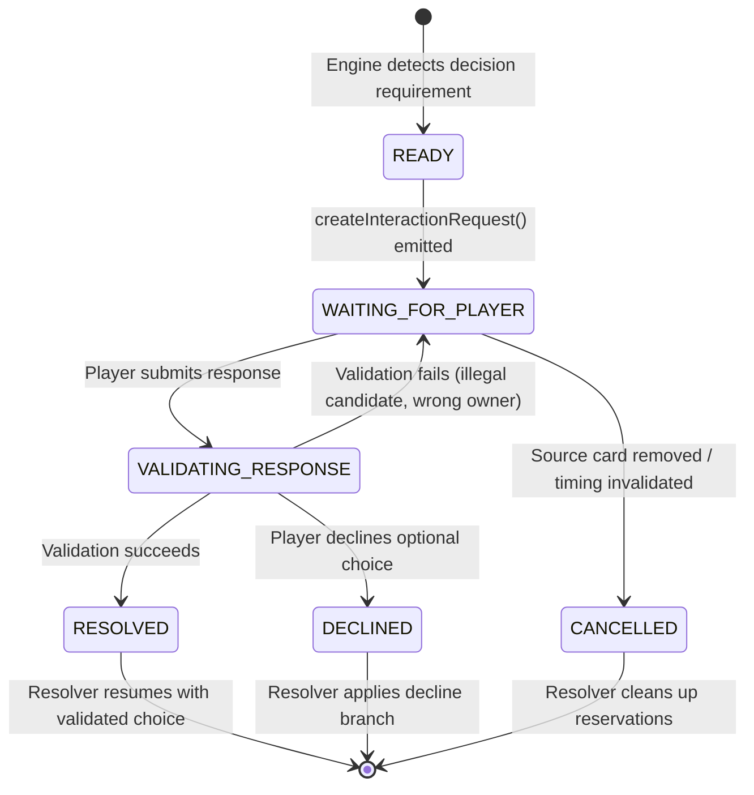

# PHASE L WORK PACKAGE B — UNIVERSAL DECISION CONTRACT & INTERACTION ARCHITECTURE

**Project:** Battle Spirits Eternal (BSP)  
**Milestone:** Phase L — Universal Player-Authoritative Effect Activation, Selection & Resolution System  
**Specification Version:** 1.0.0  
**Target Component:** `engine/interaction.js` & `engine/prompt_manager.js`

---

## 1. Architectural Mission

The Universal Decision Contract establishes an engine-authoritative, serializable, and pause-safe protocol for all player decisions in Battle Spirits Eternal.

The protocol enforces:
1. **The Engine Determines Legality:** Candidate computation, cost calculation, timing rules, and state transitions are strictly engine-owned.
2. **The Player Determines Choice:** The human player explicitly selects, confirms, declines, or orders all options permitted by the rules.
3. **No Automatic Selection:** Even when exactly one legal candidate exists, an interaction request is generated and explicit confirmation is required.

---

## 2. Canonical Interaction Request Schema

Every player decision is modeled as a normalized request containing all 22 required fields:

```typescript
interface UniversalInteractionRequest {
  // Identifiers & Context
  interactionId: string;           // Unique monotonic ID (e.g., "interaction_42")
  id: string;                      // Backward-compatibility alias
  matchId: string;                 // Active match context (e.g., "local_match")
  requestType: CanonicalRequestType; // One of 18 canonical request types
  type: CanonicalRequestType;      // Backward-compatibility alias
  requestingPlayer: string;        // Controller initiating the action or "system"
  decisionOwner: string;           // Player entitled to make the choice ('player' | 'opponent')
  player: string;                  // Backward-compatibility alias

  // Source & Effect Provenance
  sourceCardId: string | null;     // Physical card instance ID initiating effect
  sourceAbilityId: string | null;  // Logical ability ID (e.g., "BS01-017#a0")
  physicalAbilityId: string | null;// Canonical physical ability ID
  effectId: string | null;         // Specific effect clause ID
  operationId: string | null;      // Opcode identifier (e.g., "DESTROY", "BOUNCE")
  timingWindow: string;            // Active phase/step timing (e.g., "MAIN", "FLASH", "BURST")

  // Modality & Constraints
  mandatory: boolean;              // True if choice must be made; cannot be declined
  optional: boolean;               // True if choice is optional (can decline / pass)
  candidates: NormalizedCandidate[];// Legal candidate entities
  selectionConstraints: {
    min: number;                   // Minimum required selections
    max: number;                   // Maximum allowed selections
    count: number;                 // Canonical target count
    upTo: boolean;                 // Whether player may pick fewer than count
    exact: boolean;                // Whether exact count is mandatory
    maxTotalBp: number | null;     // BP ceiling constraints
    maxTotalCost: number | null;   // Cost ceiling constraints
  };
  allowedActions: string[];        // ['CONFIRM', 'DECLINE', 'SELECT', 'PASS']
  defaultAction: string | null;    // Fallback action if timed out under explicit policy
  deadlinePolicy: {
    timeoutMs: number;             // 0 for untimed human local match
    onTimeout: string;             // 'PAUSE' | 'DEFAULT'
  };
  context: object | null;          // Operational execution context

  // Lifecycle & Status
  status: InteractionStatus;       // 'READY' | 'WAITING_FOR_PLAYER' | 'RESOLVED' | 'DECLINED' | 'CANCELLED' | 'FAILED'
  createdAt: number;               // Timestamp (ms)
  resolutionMetadata: object | null;// Post-resolution execution telemetry
}
```

---

## 3. The 18 Canonical Request Types

| Request Type | Description | Candidates / Options Provided | Allowed Actions |
|---|---|---|---|
| **`ACTIVATE_EFFECT`** | Prompt to trigger or activate an eligible ability (Burst, Flash, Optional Trigger) | Ability descriptors, activation costs | `CONFIRM`, `DECLINE` |
| **`SELECT_EFFECT`** | Choose which effect to activate from multiple simultaneous triggers | List of pending eligible effects | `SELECT` |
| **`SELECT_MODE`** | Choose a mode in modal card effects | Text/IR modes of the ability | `SELECT` |
| **`SELECT_CARDS`** | Select cards from non-field zones (Hand, Trash, Revealed, Deck) | Serialized card instances with zone | `SELECT`, `CONFIRM`, `DECLINE` |
| **`SELECT_TARGETS`** | Select field stacks or cards for effect application (Destroy, Bounce, Exhaust) | Field stacks, target sides, BPs | `SELECT`, `CONFIRM`, `DECLINE` |
| **`SELECT_PLAYER`** | Choose a player (Self or Opponent) for a targeted effect | `['player', 'opponent']` | `SELECT` |
| **`SELECT_ZONE`** | Choose a destination zone (Hand, Grave, Deck Top/Bottom) | Target zone names | `SELECT` |
| **`SELECT_ORDER`** | Order simultaneous effects, re-arranged cards, or resolution chain | Items to order | `CONFIRM` |
| **`SELECT_PAYMENT_METHOD`** | Choose how to pay a cost (Cores, Sacrifices, Soul Core) | Eligible payment sources | `SELECT`, `CONFIRM` |
| **`SELECT_CORE_ALLOCATION`**| Choose specific cores to move or place on summoned spirit | Field stacks, reserve cores | `SELECT`, `CONFIRM` |
| **`SELECT_SUMMON`** | Select a card to summon from hand or trash | Summonable card candidates | `SELECT`, `CONFIRM` |
| **`SELECT_BLOCKER`** | Defending player chooses a blocker spirit | Eligible refreshed defender spirits | `SELECT`, `DECLINE` |
| **`SELECT_ATTACKER`** | Turn player chooses an attacking spirit | Eligible refreshed attacker spirits | `SELECT`, `DECLINE` |
| **`SELECT_OPTIONAL_ACTION`**| Choose whether to perform an optional effect action ("You may...") | Action description and outcome | `CONFIRM`, `DECLINE` |
| **`SELECT_REPLACEMENT_EFFECT`**| Choose between competing replacement effects | Applicable replacement rules | `SELECT` |
| **`SELECT_BRANCH`** | Select a branch in conditional branching IR | Branch descriptors | `SELECT` |
| **`CONFIRM_ACTION`** | Explicit single-candidate confirmation or mandatory prompt | Candidate entity or action details | `CONFIRM` |
| **`DECLINE_OPTIONAL_EFFECT`**| Explicit record of declining an optional action | Optional action summary | `CONFIRM` |

---

## 4. Interaction Lifecycle & State Transitions

Mermaid state diagram of the interaction protocol:



---

## 5. Security & Invariant Rules

1. **Player Authority Isolation:** Responses are checked against `decisionOwner`. If `response.player !== interaction.decisionOwner`, the submission is rejected (`UNAUTHORIZED_DECISION_OWNER`).
2. **Replay & Concurrency Protection:** Once resolved or cancelled, an `interactionId` cannot be re-submitted (`ALREADY_RESOLVED_OR_STALE`).
3. **Legal Candidate Verification:** Every item in `response.selected` must exist in `interaction.candidates`. Synthetic IDs or off-field targets are rejected fail-closed.
4. **Mandatory Non-Cancellation:** Responses containing `declined: true` or `cancelled: true` on an interaction where `mandatory === true` are rejected (`CANNOT_CANCEL_MANDATORY_INTERACTION`).
