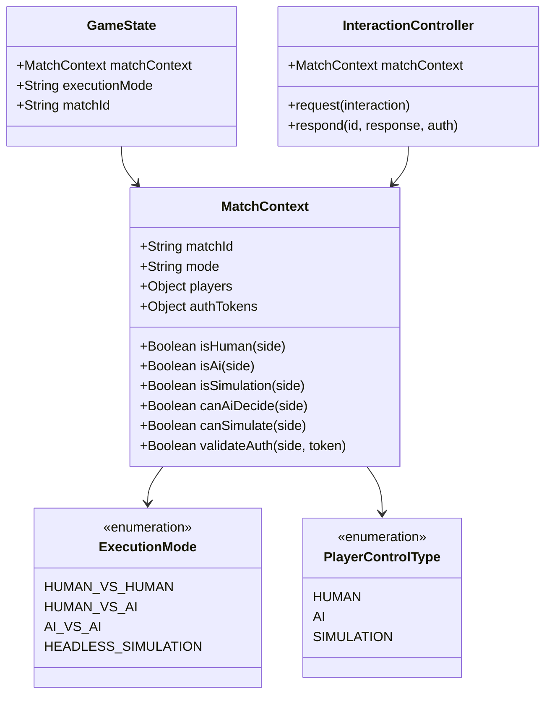

# BATTLE SPIRITS ETERNAL — PHASE L.1
# EXECUTION MODE ARCHITECTURE & PLAYER CONTROL SPECIFICATION

**Module:** `engine/session_mode.js`  
**Integration Points:** `engine/state.js`, `engine/interaction.js`, `battle_arena.js`  
**Date:** 2026-11-22  

---

## 1. Architectural Overview

Prior to Phase L.1, the engine relied on implicit heuristics (e.g. checking if `typeof document === 'undefined'`, or comparing strings against `'player'`) to determine whether a decision should be presented to a human or resolved automatically.

Phase L.1 introduces an authoritative, immutable **Match Context** that explicitly defines the execution mode and player control types for the entire match lifecycle.



---

## 2. Standard Execution Modes

| Execution Mode | Player 1 Control | Player 2 Control | AI Provider Permitted | UI Modals Required | Use Cases |
|---|---|---|---|---|---|
| **`HUMAN_VS_HUMAN`** | `HUMAN` | `HUMAN` | **STRICTLY NEVER** | Yes (Both Players) | Local Hotseat, Online PvP, Tournament Play |
| **`HUMAN_VS_AI`** | `HUMAN` | `AI` | Only for Player 2 | Yes (Player 1 Only) | Single-player Story, Practice, AI Arena |
| **`AI_VS_AI`** | `AI` | `AI` | Yes (Both Players) | Optional (Observer mode) | Bot Tournaments, Benchmark Balance |
| **`HEADLESS_SIMULATION`** | `SIMULATION` | `SIMULATION` | Guarded | No (Non-interactive) | Automated Node Tests, Fuzzing, Monte Carlo |

---

## 3. Strict Decision Authority Matrix

The decision authority of any participant is strictly governed by their configured control type, regardless of the side label (`'player'` or `'opponent'`):

```javascript
// engine/session_mode.js authority rules
canAiDecide(side) {
  if (this.mode === EXECUTION_MODES.HUMAN_VS_HUMAN) return false;
  return this.isAi(side);
}

canSimulate(side) {
  if (this.mode === EXECUTION_MODES.HUMAN_VS_HUMAN) return false;
  return this.isSimulation(side);
}
```

### Safety Invariants:
1. **Zero AI Autonomy in PvP:** In `HUMAN_VS_HUMAN`, `canAiDecide()` unconditionally returns `false`. Registered AI decision providers are never queried.
2. **Side Neutrality:** The string `'player'` indicates player 1; `'opponent'` indicates player 2. Neither string implies human or AI control.
3. **Safe Defaulting:** If an execution mode string is omitted, the engine safely defaults to `HEADLESS_SIMULATION` where player control is `SIMULATION` (not `AI`).
4. **Invalid Mode Rejection:** Unknown mode strings throw `InvalidExecutionModeError` immediately during match initialization.

---

## 4. Trusted Responder Authentication

To prevent impersonation in distributed or multi-controller environments, each player in a `MatchContext` receives an immutable, cryptographically generated token:

```javascript
matchContext.validateAuth(side, authToken)
```

- When an interaction response is submitted, `validateInteractionResponse` validates that `authContext.authToken` matches `matchContext.authTokens[side]`.
- Responses with mismatched tokens, spoofed player IDs, or invalid match IDs are rejected with:
  - `UNAUTHORIZED_RESPONDER: Mismatched authentication token`
  - `MATCH_CONTEXT_MISMATCH: Response match ID does not match active match`

---

## 5. Verification Test Evidence

The execution mode architecture is comprehensively verified in:
[tests/phase_l1_player_authority_adversarial.test.js](file:///C:/Users/namis/Downloads/BSP/tests/phase_l1_player_authority_adversarial.test.js)

- **`TC-L1-M01`**: Validates all 4 standard execution modes with explicit configurations.
- **`TC-L1-M02`**: Rejects invalid execution mode strings safely.
- **`TC-L1-M03`**: Missing execution mode safely defaults to `HEADLESS_SIMULATION` without AI privilege.
- **`TC-L1-M04`**: Rejects invalid player control types.
- **`TC-L1-P01`**: In `HUMAN_VS_HUMAN`, AI provider is NEVER invoked for either player.
- **`TC-L1-P02`**: In `HUMAN_VS_AI`, AI provider is ONLY invoked for AI decisions, never for Human decisions.
