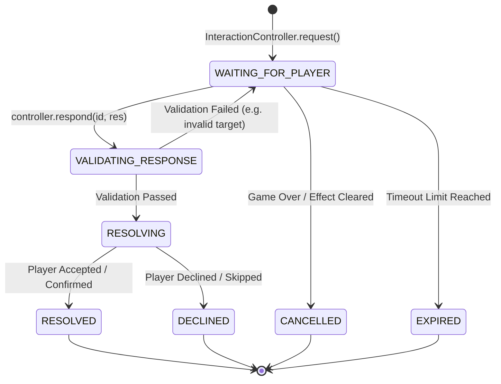

# BATTLE SPIRITS ETERNAL — PHASE L.1
# INTERACTION LIFECYCLE & STATE MACHINE TEST REPORT

**Standard:** Interaction Lifecycle Finite State Machine (FSM)  
**Primary Files:** `engine/interaction.js`, `engine/session_mode.js`  
**Test Suite:** `tests/phase_l1_player_authority_adversarial.test.js`, `tests/phase_l_player_authoritative_interactions.test.js`  
**Date:** 2026-11-22  

---

## 1. Lifecycle State Machine Architecture

Every player interaction in Battle Spirits Eternal progresses through an atomic state machine:

---

## 2. Formal State Definitions

| State Name | Description | Transitions Out | Invariant Enforced |
|---|---|---|---|
| **`WAITING_FOR_PLAYER`** | Engine suspended; waiting for player modal input | `VALIDATING_RESPONSE`, `CANCELLED`, `EXPIRED` | Resolver Promise remains pending; no engine progression |
| **`VALIDATING_RESPONSE`** | Response received; validating candidates, auth & rules | `RESOLVING` (valid), `WAITING_FOR_PLAYER` (invalid) | Atomic intermediate state; prevents concurrent replay |
| **`RESOLVING`** | Validation confirmed; committing selection to game state | `RESOLVED`, `DECLINED`, `FAILED` | Irreversible commit phase; candidate effects execute |
| **`RESOLVED`** | Interaction successfully completed | Terminal | Added to `resolvedInteractions`; replay rejected |
| **`DECLINED`** | Optional interaction declined by player choice | Terminal | Added to `resolvedInteractions`; effect safely skipped |
| **`CANCELLED`** | Interaction invalidated by game rules or target loss | Terminal | Engine state cleanly restored; no ghost resolution |
| **`EXPIRED`** | Timer deadline exceeded | Terminal | Fallback action applied per `deadlinePolicy` |
| **`FAILED`** | Irrecoverable exception during resolution | Terminal | Logged and aborted cleanly |

---

## 3. Test Verification Matrix

| Test Case | Lifecycle Transition Tested | Trigger Action | Expected Outcome | Verification Status |
|---|---|---|---|---|
| **`TC-L-10`** | `WAITING_FOR_PLAYER` Suspension | Request interaction | Promise stays pending; does not resolve synchronously | **PASSED** |
| **`TC-L-04`** | `WAITING_FOR_PLAYER` → `RESOLVED` | User clicks Confirm | Transitions to `RESOLVED`; effect executes | **PASSED** |
| **`TC-L-04`** | `WAITING_FOR_PLAYER` → `DECLINED` | User clicks Decline | Transitions to `DECLINED`; effect skipped | **PASSED** |
| **`TC-L1-A03`** | Anti-Replay Guard | Second response sent | Rejects with `ALREADY_RESOLVED_OR_STALE` | **PASSED** |
| **`TC-L-05`** | Atomic Validation Rollback | Empty selection sent | Rejection reverts state to `WAITING_FOR_PLAYER` | **PASSED** |
| **`TC-L1-C04`** | Current-State Revalidation | Target killed in pending | Rejects with `CANDIDATE_NO_LONGER_VALID_IN_CURRENT_STATE` | **PASSED** |
| **`TC-L1-R01`** | Stack Order in Nested FSM | Child interaction spawned | Child resolves first; parent resumes without scope loss | **PASSED** |

---

## 4. Conclusion

The interaction lifecycle guarantees complete traceability, determinism, and safety against re-entrancy and race conditions.
