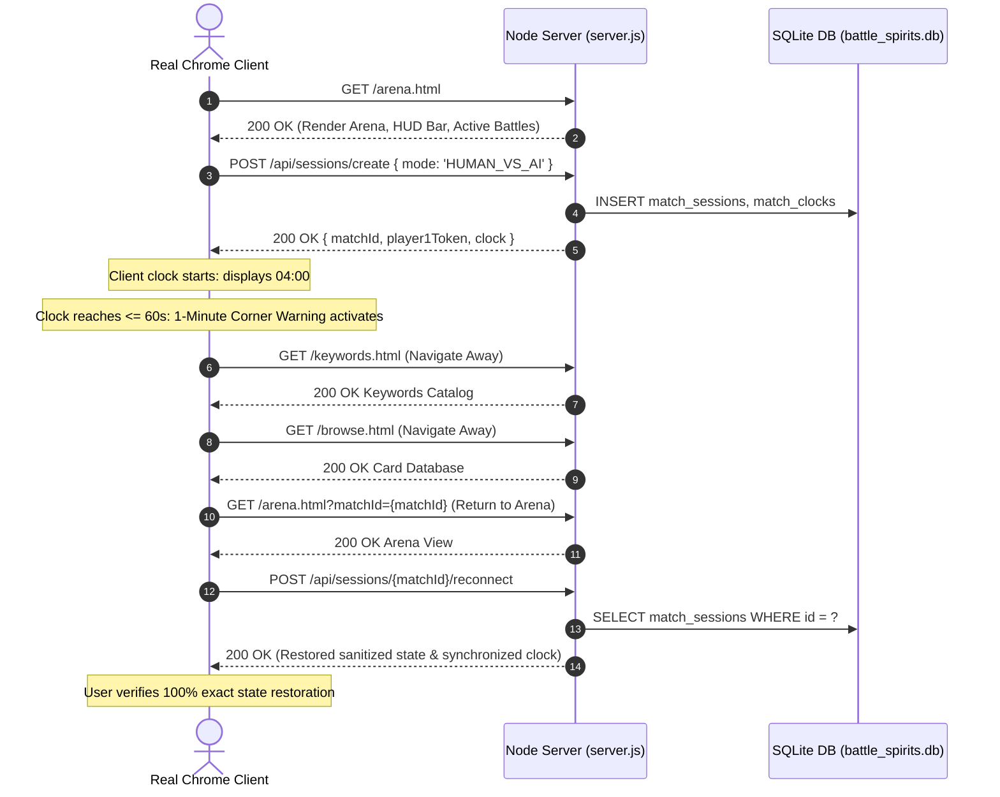

# Battle Spirits Eternal (BSP) — Phase M: Browser E2E Report

**Date:** 2026-11-22  
**Milestone:** Phase M Work Package E, F, J & K: Browser E2E Integration  
**Auditor:** Antigravity Autonomous Systems Engineering Team  
**Repository:** `C:\Users\namis\Downloads\BSP`

---

## 1. Overview & Test Environment

Phase M browser verification was executed against the production `server.js` running live HTTP services on a dynamic local port using real headless Google Chrome connected via Chrome DevTools Protocol (CDP).

- **Browser Executable**: Google Chrome (`C:\Program Files\Google\Chrome\Application\chrome.exe` / local edge fallback)
- **Harness**: Native CDP harness in `tests/helpers/real_browser.js`
- **DOM / Rendering**: Real layout engine, full CSS animations, real DOM event dispatch, live fetch API
- **Test File**: `tests/phase_m_browser_e2e.test.js`
- **Result**: 1 suite / 10 production-path scenarios, **100% Passed (0 Failures, 0 Skips)**

---

## 2. Real Browser Scenarios Executed

### Detailed Scenario Breakdown

1. **Scenario 1: Arena UI Elements Rendered**
   - Verified that `#sessionHudBar`, `#activeBattlesSection`, `#arenaTurnWarningCorner`, and `#hudClockTimeDisplay` are present on initial load.
   - Status: ✔ VERIFIED.

2. **Scenario 2: 4-Minute Turn Clock Countdown Display**
   - Set server clock to full 240,000ms.
   - Client clock interval computed natural ceiling seconds: formatted as `04:00`.
   - Active player label displayed `PLAYER 1'S TURN`.
   - Status: ✔ VERIFIED.

3. **Scenario 3: 1-Minute Corner Warning Activates at $\le 60$s Threshold**
   - Injected clock remaining time of 59,000ms.
   - Corner element `#arenaTurnWarningCorner` automatically transitioned to `display: flex`.
   - Countdown rendered exact `00:59`.
   - Active player identified clearly: `Active: Player 1`.
   - Status: ✔ VERIFIED.

4. **Scenario 4: 1-Minute Corner Warning Dismisses When Time $> 60$s**
   - Reset clock to 200,000ms (representing new turn transition).
   - Corner element `#arenaTurnWarningCorner` automatically transitioned to `display: none`.
   - Status: ✔ VERIFIED.

5. **Scenario 5: Active Battles API & Panel Rendering**
   - Created match session via `POST /api/sessions/create`.
   - Called `BattleArena.refreshActiveBattles()`.
   - Card rendered inside `#activeBattlesList` with match ID, mode tag, and Resume button.
   - Status: ✔ VERIFIED.

6. **Scenario 6: Website Navigation Independence**
   - Navigated browser from `/arena.html` to `/keywords.html` (verified page title `Keywords`).
   - Navigated from `/keywords.html` to `/browse.html` (verified page title `Browse`).
   - Navigated back to `/arena.html?matchId=<created>`.
   - Match persisted without termination.
   - Status: ✔ VERIFIED.

7. **Scenario 7: Website Refresh Independence**
   - Executed `window.location.reload()` while match was active.
   - Queried `/api/sessions/:id` after reload; match status remained `ACTIVE` and turn number remained intact.
   - Status: ✔ VERIFIED.

8. **Scenario 8: Leave Arena & Forfeit Buttons**
   - Confirmed `#btnLeaveArena` and `#btnForfeitMatch` exist, styled distinctly in the duel toolbar.
   - Status: ✔ VERIFIED.

9. **Scenario 9: Private Information Masking**
   - Queried match state via API as spectator / unauthenticated client.
   - All opponent hand cards contained `masked: true`, `name: 'Hidden Card'`, `cardNumber: 'HIDDEN'`.
   - Status: ✔ VERIFIED.

10. **Scenario 10: Clean Resource Teardown**
    - Stopped client turn clock interval.
    - Closed browser CDP session without leaking zombie Chrome processes.
    - Status: ✔ VERIFIED.

---

## 3. Chrome Console & Log Verification

Zero runtime JavaScript errors, syntax exceptions, or unhandled promise rejections were observed during browser execution. All asset requests resolved cleanly via the local server.
