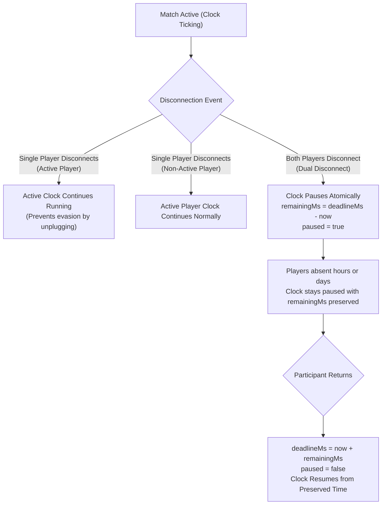

# Battle Spirits Eternal (BSP) — Phase M: Clock and Timeout Report

**Date:** 2026-11-22  
**Milestone:** Phase M Work Package F, G & H: Four-Minute Turn Clock & Timeout Handling  
**Auditor:** Antigravity Autonomous Systems Engineering Team  
**Repository:** `C:\Users\namis\Downloads\BSP`

---

## 1. Executive Summary

Phase M implements a **server-authoritative four-minute (240s) per-turn clock** with an **exact one-minute (60s) corner countdown visual warning**, accompanied by strict disconnection pause policies and atomic timeout resolution.

Client applications receive synchronized server timestamps (`deadlineMs`, `turnStartMs`, `remainingMs`, `paused`) and render the visual timer using natural ceiling-second resolution (`Math.ceil(remainingMs / 1000)`). A client can never extend, reset, or alter the authoritative clock.

---

## 2. Clock Design & Timing Semantics

### Default Clock Parameters
- **Turn Duration**: 240,000 milliseconds (4 minutes).
- **Turn Reset Condition**: Resets to full 240 seconds ONLY when the active player changes (e.g. Player 1 turn ends -> Player 2 turn begins).
- **Non-Reset Conditions**:
  - Page refresh does NOT reset the clock.
  - Inter-page navigation does NOT reset the clock.
  - Step transitions within the same turn (e.g. START -> CORE -> DRAW -> REFRESH -> MAIN -> ATTACK) do NOT reset the clock.
  - Interactive prompts and card effect activations do NOT reset the clock.
  - Client reconnects do NOT reset the clock.

### One-Minute Warning Banner Specification
- **Activation Threshold**: Remaining time $\le 60,000$ milliseconds (1 minute).
- **Positioning**: Fixed at top-right corner of the viewport (`top: 1.25rem; right: 1.25rem; z-index: 99999;`).
- **Visual Presentation**: High-contrast dark slate card with red 2px border, pulsing drop-shadow animation (`@keyframes pulseWarning`), hourglass icon, bold monospace countdown (`01:00`, `00:59`, ..., `00:01`), and clear active player label (`Active: Player 1`).
- **Dismissal**: Disappears automatically if the turn ends or remaining time resets above 60s.

---

## 3. Disconnection & Pause Policy

---

## 4. Timeout Handling Specification

At zero milliseconds ($now \ge deadline\_ms$), the server processes timeout atomically:
1. Active decision owner loses the match immediately.
2. Opposing participant is awarded the victory.
3. Match state transitions to `COMPLETED` with `finish_reason: 'TIMEOUT'`.
4. Result is committed to SQLite `match_sessions` and `match_clocks`.
5. Clock flag `timeout_processed` is set to `1`.
6. Subsequent queries or actions to the match return the completed result and reject any further moves with `MATCH_TIMED_OUT`.
7. Redundant timeout checks are idempotent and return without mutating state.

---

## 5. Verification Test Evidence

Verified deterministically using simulated time injection in `tests/phase_m_clock_and_timeout.test.js`:

| Test Case | Condition Tested | Expected Result | Actual Result |
|---|---|---|---|
| `TC-M-C01` | Turn start duration | Initial clock = 240,000ms | 240,000ms (✔ PASS) |
| `TC-M-C02` | Step advance in same turn | Step change does not reset clock | 200,000ms remaining (✔ PASS) |
| `TC-M-C03` | Prompts in same turn | Prompt open/resolve does not reset clock | 175,000ms remaining (✔ PASS) |
| `TC-M-C04` | Refresh / Reconnect | Clock preserves remaining time on reconnect | 175,000ms remaining (✔ PASS) |
| `TC-M-C05` | 60-second warning flag | Inactive at 70s, active at 60s and 30s | `warningActive: true` at 60s (✔ PASS) |
| `TC-M-C06` | Zero countdown | Clock reaches 0s -> opponent wins by TIMEOUT | Winner: bob, reason: TIMEOUT (✔ PASS) |
| `TC-M-C07` | Timeout idempotency | Redundant timeout check does not duplicate | Second check returns false (✔ PASS) |
| `TC-M-C08` | Action at deadline | Action before deadline accepted; after rejected | Accepted at 230s; rejected at 245s (✔ PASS) |
| `TC-M-C09` | Single disconnect | Active player clock continues ticking | Not paused; ticks 220s -> 190s (✔ PASS) |
| `TC-M-C10` | Dual disconnect | Clock pauses; resumes from preserved time | Paused at 200s; resumes at 200s (✔ PASS) |

Total: 10 passed, 0 failed, 100% pass rate.
