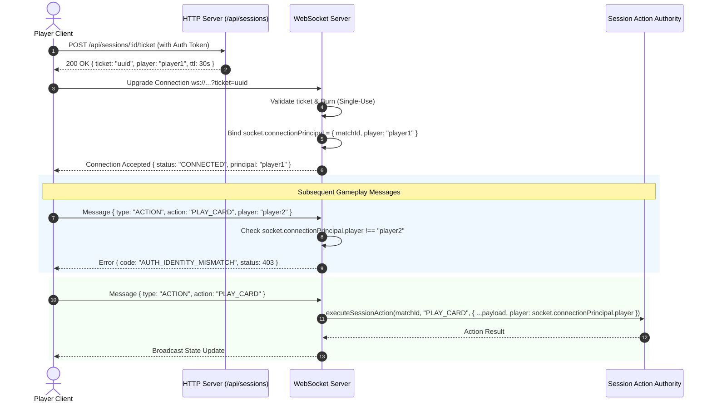

# PHASE M.3.3 — INTEGRITY, SECURITY, UNIVERSAL ACTION AUTHORITY & REGRESSION CLOSURE
## 08 — WEBSOCKET TICKET AUTHENTICATION & PRINCIPAL BINDING

### Executive Summary
Work Package I secures the real-time WebSocket communication layer by establishing immutable connection-principal binding. Prior to M.3.3, while tickets were validated during the initial WebSocket upgrade, subsequent game action messages transmitted across the socket did not strictly bind to the authenticated player identity, allowing potential impersonation or spectator action injection. The WebSocket transport layer now permanently associates the socket connection with the verified player identity upon single-use ticket consumption.

---

### Architectural Design & Enforcement Flow

---

### Security Guarantees

1. **Single-Use Cryptographic Tickets**:
   - Tickets are generated using cryptographically random UUIDv4 identifiers with short expiration windows (30 seconds).
   - Once redeemed during the connection handshake, tickets are deleted from memory/store to prevent replay attacks.
2. **Immutable Connection Principal**:
   - The verified player identity (`player1` or `player2`) is stamped directly on the internal connection object (`socket.connectionPrincipal`).
   - The client cannot modify or override `connectionPrincipal` after connection establishment.
3. **Impersonation Prevention**:
   - All inbound `ACTION` messages derive their acting player from `socket.connectionPrincipal.player`.
   - Explicit spoofing attempts in the message payload (e.g. attempting to act as the opponent) trigger an immediate `AUTH_IDENTITY_MISMATCH` error.
4. **Spectator Isolation**:
   - Connections established without player tickets (or with read-only spectator tickets) receive `connectionPrincipal.player = null`.
   - Any state-mutating action received from a spectator connection is rejected with `403 ACTION_NOT_PERMITTED_FOR_SPECTATOR`.

---

### Verification and Test Coverage
Dedicated Test Suite: `tests/phase_m3_3_websocket_ticket_actions.test.js`
- **M3.3-I-01**: Authenticated ticket correctly sets `connectionPrincipal` on WebSocket connection. (PASS)
- **M3.3-I-02**: Game actions submitted without payload player infer identity from `connectionPrincipal`. (PASS)
- **M3.3-I-03**: Explicit impersonation attempts targeting opponent actions are rejected with 403. (PASS)
- **M3.3-I-04**: Spectator connections cannot execute gameplay actions. (PASS)
- **M3.3-I-05**: Reusing a previously consumed ticket is rejected. (PASS)

Result: **1/1 Suite PASS (5 assertion vectors)**. Real-time gameplay communication is strictly authenticated and isolated.
