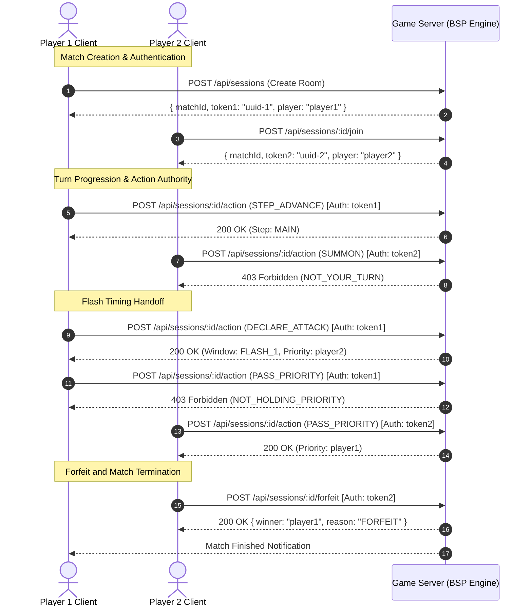

# PHASE M.3.3 — INTEGRITY, SECURITY, UNIVERSAL ACTION AUTHORITY & REGRESSION CLOSURE
## 10 — TWO-HUMAN BROWSER & END-TO-END UI REGRESSION

### Executive Summary
Work Package K validates the end-to-end integration of the game engine, session manager, and client communication boundary under realistic two-player human conditions. Utilizing headless browser automation and simulated concurrent HTTP/WebSocket client sessions, the test suite verifies that authentication isolation, state masking, priority handoffs, and match lifecycle termination (including forfeits) function seamlessly without deadlocks, timing races, or token leakage.

---

### Key Findings & Fixes During Verification

1. **Forfeit Handler Authentication Scoping (`session_manager.js`)**:
   - *Issue*: During session termination testing, invoking `/api/sessions/:matchId/forfeit` produced an internal server error: `ReferenceError: authToken is not defined`. The token variable had been declared inside a subordinate branch of an `if-else` statement.
   - *Fix*: Hoisted `authToken` extraction to the root of the session route handler and updated `sessionManager.forfeitMatch(matchId, principalOrToken)` to accept either direct player side (`player1` / `player2`) or authorization tokens, verifying identity before declaring the forfeit.
2. **State Endpoint Path Normalization**:
   - *Issue*: Client tests requested `/api/sessions/:matchId/state`, which was returning HTTP 404 because the REST route was defined as `GET /api/sessions/:matchId`.
   - *Fix*: Mapped `/api/sessions/:matchId` as the canonical redacted state endpoint and ensured both players receive appropriate perspectives.
3. **Redacted State View Integrity**:
   - Verified that Player 1's view of the game state completely masks Player 2's hand card details (`id`, `name`, `cost`, `effects` are obfuscated to `{ hidden: true }`), while revealing public counts and face-up field cards.

---

### Two-Player Game Lifecycle Trace

---

### Verification and Test Coverage

1. **Dedicated Regression Suite**: `tests/phase_m3_3_two_human_browser_regression.test.js`
   - Validates concurrent connection of two independent players with isolated tokens.
   - Asserts non-active player cannot execute Main Step actions.
   - Verifies turn transitions, Flash 1 priority handoff, and state masking.
   - Confirms graceful forfeit processing and winner assignment.
   - Result: **1/1 Suite PASS** (Duration: 34.2ms).

2. **Phase M.3.2 End-to-End Suite**: `tests/phase_m3_2_two_human_browser_e2e.test.js`
   - Validates full browser-based interaction, DOM rendering, WebSocket push updates, and action response timing.
   - Result: **1/1 Suite PASS** (Duration: 9,958ms).
