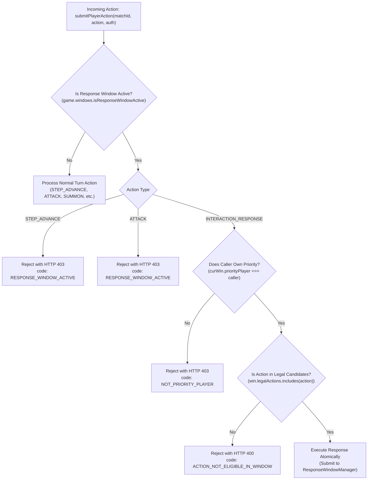

# Phase M.3 — Action Progression Locking Specification & Verification

## 1. Core Principles & Motivation

In Battle Spirits Eternal (BSP), rules progression must never be circumvented by eager client submissions or out-of-order player inputs. Under Official Rule Manual [Eternal] Ver. 17.0, when a response window (e.g. Flash Timing 1, Block Declaration, Flash Timing 2, or Burst Trigger) is active:
1. The game flow is paused.
2. The player holding priority is the only entity authorized to act or pass.
3. Non-priority actions (such as declaring another attack, advancing the turn step, or playing out-of-turn cards) must be authoritatively locked out.

---

## 2. Engine & Session Layer Progression Locks

---

## 3. Strict Rejection Policies & HTTP Contract

### 3.1 Step Advance Lock (`RESPONSE_WINDOW_ACTIVE`)
- If `action.type === 'STEP_ADVANCE'` while `game.windows.isResponseWindowActive()` is true:
  - Error: `RESPONSE_WINDOW_ACTIVE: Cannot advance step while response window "${curWin.windowType}" is active`
  - Code: `RESPONSE_WINDOW_ACTIVE`
  - HTTP Status: `403 Forbidden`

### 3.2 Attack Declaration Lock (`RESPONSE_WINDOW_ACTIVE`)
- If `action.type === 'ATTACK'` while `game.windows.isResponseWindowActive()` is true:
  - Error: `RESPONSE_WINDOW_ACTIVE: Cannot declare attack while response window "${curWin.windowType}" is active`
  - Code: `RESPONSE_WINDOW_ACTIVE`
  - HTTP Status: `403 Forbidden`

### 3.3 Out-of-Priority Rejection (`NOT_PRIORITY_PLAYER`)
- If caller attempts to submit a response when `curWin.priorityPlayer !== caller`:
  - Error: `NOT_PRIORITY_PLAYER: Response window "${curWin.windowType}" priority is owned by "${curWin.priorityPlayer}", but caller is "${caller}"`
  - Code: `NOT_PRIORITY_PLAYER`
  - HTTP Status: `403 Forbidden`

### 3.4 Transaction Integrity & Zero Side-Effects
- Rejected actions do not mutate `state.players`, `state.combat`, `state.step`, or core balances.
- No `eventRecord` is appended to the match database.
- Monotonic event sequence numbers (`eventSeq`) remain unincremented, preventing sequence fragmentation.

---

## 4. Automated Verification Matrix

All progression locking requirements are verified by automated tests in `tests/phase_m3_action_progression_lock.test.js`:
- `PHASE-M3-LOCK-01`: Rejects `STEP_ADVANCE` while Flash 1 window is open (HTTP 403 / `RESPONSE_WINDOW_ACTIVE`).
- `PHASE-M3-LOCK-02`: Rejects `ATTACK` while response window is open (HTTP 403 / `RESPONSE_WINDOW_ACTIVE`).
- `PHASE-M3-LOCK-03`: Rejects out-of-priority response submissions (HTTP 403 / `NOT_PRIORITY_PLAYER`).
- `PHASE-M3-LOCK-04`: State serialization and restoration preserves `responseWindow` and priority owner without clearing locks.
