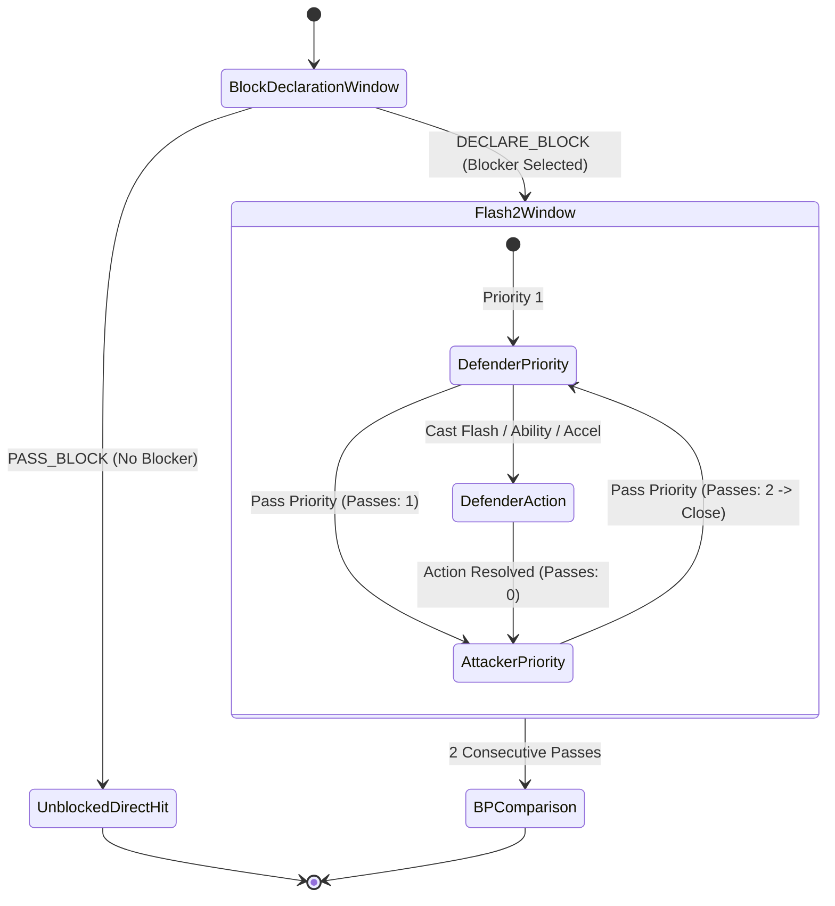

# Phase M.3 — Block Declaration & Second Flash Engine Specification

## 1. Overview

This document details the mechanics, state transitions, and validation rules governing the Block Declaration Step and Second Flash Timing (`FLASH_2`) implemented in Battle Spirits Eternal (BSP) under Phase M.3.

---

## 2. Block Declaration Rules & Processing Pipeline

### 2.1 Blocker Eligibility & Selection
When the Block Declaration window opens, the engine calculates the candidate list of eligible blockers for the defending player:
1. Spirit or Ultimate controlled by the defending player.
2. Must be in `REFRESHED` state (or possess an ability allowing blocking while exhausted).
3. Must satisfy all active field restrictions (`canBlock(state, stack)`).

### 2.2 Processing Block Declaration (`DECLARE_BLOCK`)
1. **Validation**: The engine validates that the specified `blockerStackId` belongs to the defender and is legally able to block.
2. **Exhaustion**: The blocker stack is transitioned from `REFRESHED` to `EXHAUSTED` (or `HEAVY_EXHAUSTED` if previously exhausted). An authoritative `CARD_EXHAUSTED` event is emitted.
3. **Event Emission**: Emits `BLOCK_DECLARED` with blocker stack metadata.
4. **Trigger Resolution**: Resolves any `WHEN_BLOCKS`, `WHEN_ATTACKS_OR_BLOCKS`, or `WHEN_BATTLES` abilities on the blocker.
5. **State Update**: Updates `state.combat.blockerStackId = blockerStackId` and sets `state.combat.stage = 'BP_COMPARE'`.
6. **Open Second Flash Timing**: The engine automatically opens `FLASH_2`, granting Priority 1 to the defending player.

### 2.3 Processing Pass Block (`PASS_BLOCK`)
1. **Validation**: The defending player elects not to declare a blocker.
2. **Flash 2 Bypass**: Second Flash Timing (`FLASH_2`) is **completely skipped**.
3. **Direct Hit Resolution**: The engine invokes `resolveDirectHit()`, applying symbol damage directly to the defending player's Life.
4. **Burst Trigger Check**: If Life is reduced, a Burst response window opens immediately before combat closes.

---

## 3. Second Flash Timing (`FLASH_2`) Mechanics

---

## 4. Authoritative BP Comparison (`resolveBattleComparison`)

Upon closure of `FLASH_2` (after two consecutive passes):
1. **BP Calculation**: Computes effective BP for attacker and blocker stacks, including all level bonuses, Brave additions, and continuous modifier effects.
2. **Comparison Outcomes**:
   - `Attacker BP > Blocker BP`: Blocker is destroyed. Sent to Trash via `destroyCard` with reason `battle`.
   - `Blocker BP > Attacker BP`: Attacker is destroyed. Sent to Trash via `destroyCard` with reason `battle`.
   - `Attacker BP == Blocker BP`: Both Spirits are destroyed and sent to Trash.
3. **Destruction Protection**: Evaluates `indestructible` continuous effects and destruction-prevention replacement effects.
4. **Post-Battle Cleanup**: Cleans up combat state and returns control to the Main Step.
