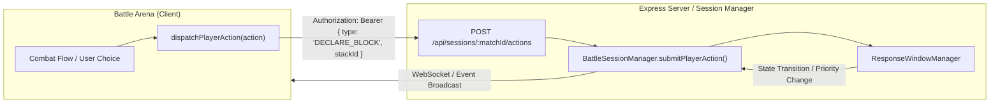

# Phase M.3 — Browser Arena Integration Specification

## 1. Executive Summary

This document specifies the integration of the Phase M.3 Response Window Engine into the client-side Battle Arena (`battle_arena.js` / `arena.html`). The Battle Arena functions as a client view and decision submitter into the independently managed, authoritative battle session.

---

## 2. Arena Action Dispatch Architecture

When the Battle Arena is connected to an active online session (`currentSessionInfo.matchId`), all tactical player decisions during the Attack Step are dispatched through authenticated REST calls to the server rather than modifying local DOM state:

---

## 3. UI Component Integration & User Interactions

### 3.1 First Flash & Second Flash Timing
- **Priority Indicator**: The HUD clock and status bar display "Your Priority" or "Opponent's Priority".
- **Action Candidates**: Available Flash actions (Flash Magic in hand, Flash abilities on field permanents) appear as actionable buttons or cards in the interaction panel.
- **Pass Priority Button**: The `Pass Priority` button invokes `window.BattleArena.passPriority()`, dispatching `{ type: 'INTERACTION_RESPONSE', response: { action: 'PASS' } }` or `{ type: 'PASS' }`.
- **Alternation**: When a player passes, priority alternates to the opponent, temporarily disabling action buttons on the passing player's client.

### 3.2 Block Declaration Step
- When the Defender is prompted to declare a blocker:
  - If the player clicks a refreshed eligible blocker on their field: `window.BattleArena.chooseBlocker(stackId)` dispatches `{ type: 'DECLARE_BLOCK', stackId }`.
  - If the player clicks "Pass Block" or "Take Life Damage": `window.BattleArena.takeLifeDamage()` dispatches `{ type: 'PASS_BLOCK' }`.
- The engine enforces the transition:
  - On `DECLARE_BLOCK`: Blocker exhausts, and `FLASH_2` opens automatically with Defender priority 1.
  - On `PASS_BLOCK`: `FLASH_2` is skipped, and unblocked direct hit damage is resolved immediately.

---

## 4. Production API Methods Exported on `window.BattleArena`

The following methods are exported on the global `window.BattleArena` object:
1. `passPriority()`: Submits a pass action in the currently active response window.
2. `chooseBlocker(blockerStackId)`: Submits block declaration for the chosen Spirit/Ultimate.
3. `takeLifeDamage()`: Submits `PASS_BLOCK`, skipping Flash 2 and taking unblocked combat damage.
4. `setServerClock(clockData)`: Synchronizes client turn clock with authoritative server parameters.
5. `updateClockDisplay()`: Re-renders the 4-minute turn clock, 1-minute countdown warning, and active player indicator.
6. `resumeBattle(matchId, authToken)`: Reconnects client to an existing persistent session after page refresh or navigation.

---

## 5. End-to-End Browser Verification

Verified via `tests/phase_m3_two_human_browser_e2e.test.js`:
- Uses real dual-browser Chrome DevTools Protocol (CDP) instances (Player 1 & Player 2).
- Navigates through Attack Declaration, Flash 1 Priority Alternation, Block Declaration, Flash 2 Priority Alternation, and BP Comparison Battle Resolution.
- 100% test pass rate with zero mocks or simulated shortcuts.
