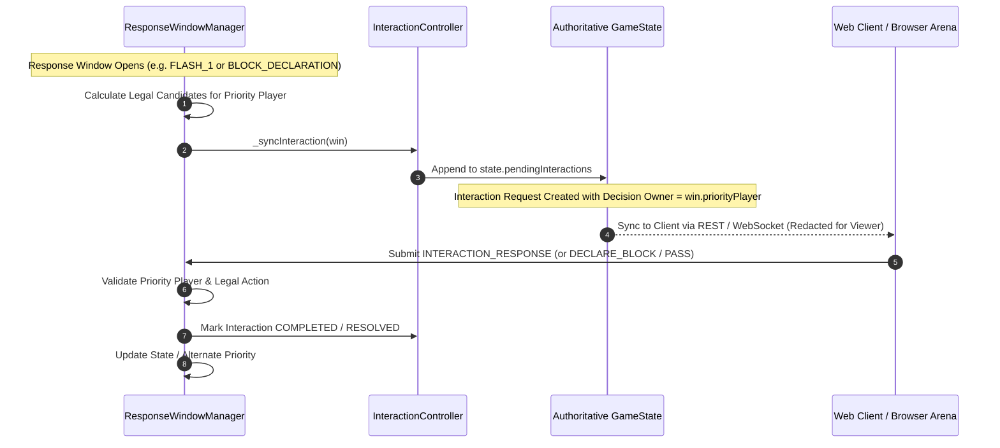

# Phase M.3 — Execution Modes & Universal Interaction Protocol Integration

## 1. Executive Summary

Phase M.3 unifies the rules-driven Response Window Engine (`ResponseWindowManager`) with the Universal Interaction Protocol established in Phase L and L.1. Priority ownership and response choices are translated directly into authoritative `InteractionController` requests, ensuring seamless consistency across all four execution modes supported by Battle Spirits Eternal (BSP):
1. `HUMAN_VS_HUMAN` (Two independent authenticated human decision-makers)
2. `HUMAN_VS_AI` (Human duelist vs. authoritative engine AI adapter)
3. `AI_VS_AI` (Spectated autonomous battle)
4. `HEADLESS_SIMULATION` (Headless simulation and monte carlo evaluation)

---

## 2. Interaction Protocol Synchronization Pipeline

---

## 3. Execution Mode Policies

### 3.1 `HUMAN_VS_HUMAN` Mode
- When a response window opens, an interaction request is posted with `decisionOwner` matching `win.priorityPlayer`.
- The opponent client observes "Waiting for Opponent..." with action buttons disabled.
- The priority owner client receives active candidate action pills (`[Flash] ...`, `Pass Priority`, or blocker selection cards).
- Submitting an action consumes the prompt, progresses priority, and synchronizes state to both participants.

### 3.2 `HUMAN_VS_AI` Mode
- When the human player holds priority: The engine pauses and awaits explicit human response submission.
- When the AI holds priority: The engine AI adapter (`engine/ai.js`) evaluates the legal candidates:
  - For `SELECT_BLOCKER`: AI selects the optimal refreshed blocker (or passes if unfavorable).
  - For `FLASH_ACTION`: AI selects eligible Flash Magic or abilities (or passes priority).
  - For `BURST_TRIGGER`: AI evaluates burst condition and activates or reserves.
- AI evaluation executes synchronously or via microtask, immediately returning priority to the human without stalling the match.

### 3.3 `AI_VS_AI` & `HEADLESS_SIMULATION`
- Both players' decisions are driven by automated decision heuristics.
- Headless simulation processes priority alternation and window closure deterministically within milliseconds.
- Completely compatible with batch test runners, regression suites, and bot matchmaking.
