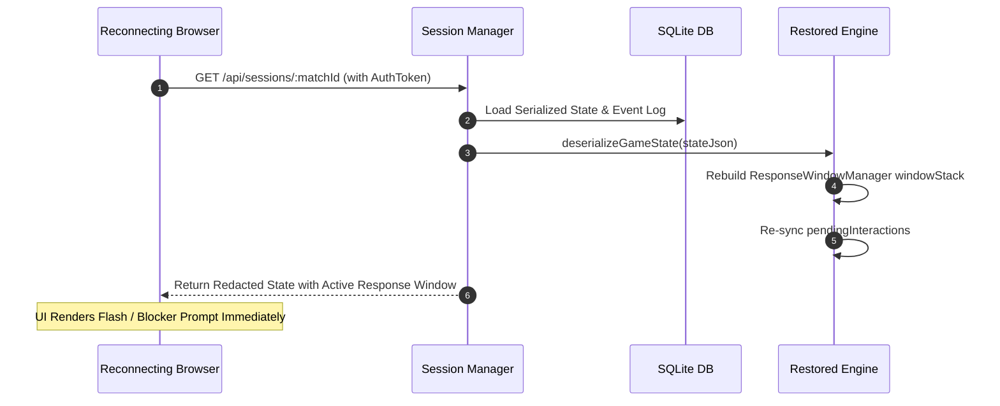

# Phase M.3 — Response Window Persistence & Reconnection Specification

## 1. Executive Summary

This document specifies how the Response Window Engine (`ResponseWindowManager`) serializes, persists, and reconstructs response windows and priority states across SQLite-backed persistent battle sessions, server restarts, page reloads, and browser reconnections.

---

## 2. Serialization Schema (`state.responseWindow`)

In `engine/state_serialization.js`, `serializeGameState` serializes the active response window:

```javascript
// Response Window Serialization
if (state.responseWindow) {
  serialized.responseWindow = {
    windowId: state.responseWindow.windowId || state.responseWindow.id,
    windowType: state.responseWindow.windowType || state.responseWindow.type,
    timing: state.responseWindow.timing,
    originatingAction: state.responseWindow.originatingAction,
    activePlayer: state.responseWindow.activePlayer,
    opposingPlayer: state.responseWindow.opposingPlayer,
    attackerStackId: state.responseWindow.attackerStackId,
    attackerSide: state.responseWindow.attackerSide,
    defenderSide: state.responseWindow.defenderSide,
    priorityPlayer: state.responseWindow.priorityPlayer,
    eligiblePlayers: state.responseWindow.eligiblePlayers ? [...state.responseWindow.eligiblePlayers] : [],
    legalActions: state.responseWindow.legalActions ? [...state.responseWindow.legalActions] : [],
    consecutivePasses: state.responseWindow.consecutivePasses || 0,
    resolutionStatus: state.responseWindow.resolutionStatus || state.responseWindow.status,
    originatingInteractionId: state.responseWindow.originatingInteractionId,
    interruptible: Boolean(state.responseWindow.interruptible),
    resumable: Boolean(state.responseWindow.resumable),
    createdAt: state.responseWindow.createdAt || Date.now(),
    version: state.responseWindow.version || 1
  };
}
```

---

## 3. Reconstitution on Restore (`deserializeGameState`)

When restoring a match from SQLite persistence:
1. `state.responseWindow` is reconstituted as a full window object.
2. The game's `ResponseWindowManager` (`game.windows`) rebuilds its `windowStack` with the restored window.
3. Legal candidate response actions are recalculated dynamically against the current board state (`windows.refreshWindowCandidates(restored)`).
4. `_syncInteraction(restored)` ensures the corresponding `pendingInteractions` entry is alive and available to the client.

---

## 4. Viewer-Specific Redaction

Under `redactGameStateForViewer(state, viewerSide)`:
- If `state.responseWindow` is active:
  - If `viewerSide === state.responseWindow.priorityPlayer`: The viewer sees full candidate details (e.g. available Flash Magic cards in hand, Flash abilities on field, blocker choices).
  - If `viewerSide !== state.responseWindow.priorityPlayer`: Private card identifiers or hand card secrets in candidate pools are masked, while high-level window metadata (`windowType`, `timing`, `priorityPlayer`) remains visible so the client UI can display appropriate wait status.

---

## 5. Reconnection Lifecycle


