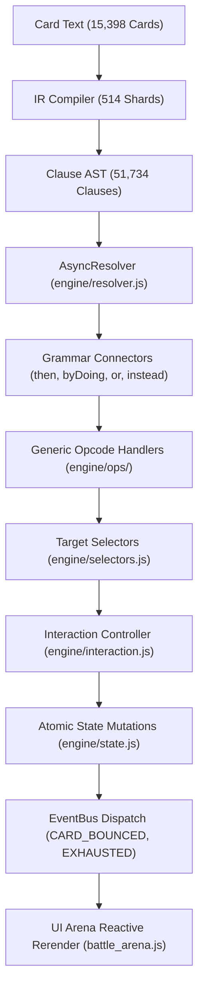

# Effect Engine Architecture — Battle Spirits Eternal

**Project:** Battle Spirits Eternal (BSP)  
**Workspace:** `C:\Users\namis\Downloads\BSP`  
**Date:** 2026-11-21  

---

## 1. Architectural Pipeline

The Battle Spirits Eternal effect execution engine translates natural language card text into deterministic game state mutations through a multi-tiered pipeline:

---

## 2. Core Engine Components

### 2.1 AsyncResolver (`engine/resolver.js`)
- The central orchestrator that evaluates an ability's structured IR tree.
- Manages clause sequencing and logical grammar links:
  - `then`: Sequential execution; if clause 1 succeeds, execute clause 2.
  - `byDoing`: Prerequisite link; clause 2 executes ONLY IF the cost/action in clause 1 completed successfully (e.g. "By destroying one of your spirits, draw 2 cards").
  - `or`: Modal branching; executes the chosen branch.
  - `instead`: Replacement effect; intercepts a trigger event and substitutes an alternate state transition (e.g. "When this spirit would be destroyed, by discarding 1 card from hand, it remains on field").
  - `afterResolves`: Post-resolution trigger queuing.

### 2.2 Target Selectors (`engine/selectors.js`)
- Evaluates candidate pools across all zones (`field`, `reserve`, `trash`, `hand`, `deck`, `void`).
- Applies criteria:
  - Cost filters (`cost <= 4`, `max cost`).
  - BP filters (`BP <= 5000`, `lowest BP`).
  - Type filters (`spirit`, `brave`, `nexus`, `magic`).
  - Family/Trait filters (`God-Emperor`, `Astral Dragon`, `Kamen Rider`).
  - Side narrowing: Distinguishes `player` vs `opponent` without regex false-matches.
  - Extreme ties: Handled gracefully (e.g. if 2 spirits tie for lowest BP, candidate list includes both for player selection).

### 2.3 Opcode Handlers (`engine/ops/index.js`)
- Houses 288 distinct opcode handlers adhering to the Battle Spirits Eternal format profile (`engine/rules/eternal.js`).
- Never keys effect logic on card names or free text.
- Ensures atomic rollback if an intermediate operation fails during a prerequisite check.

### 2.4 Core Conservation & The Void Pool Invariant (`CORR-CORE-03`)
In Battle Spirits, cores are strictly conserved physical tokens. 
- Cores move between `Void`, `Reserve`, `Field (Spirits/Nexuses)`, `Trash`, and `Life`.
- **The Invariant:** During the Core Step, moving 1 core from Void to Reserve is contingent on `voidCores.normal > 0`. If the Void pool is exhausted, no phantom cores can be synthesized into the game. Total cores across all zones must equal the initial game constant.
