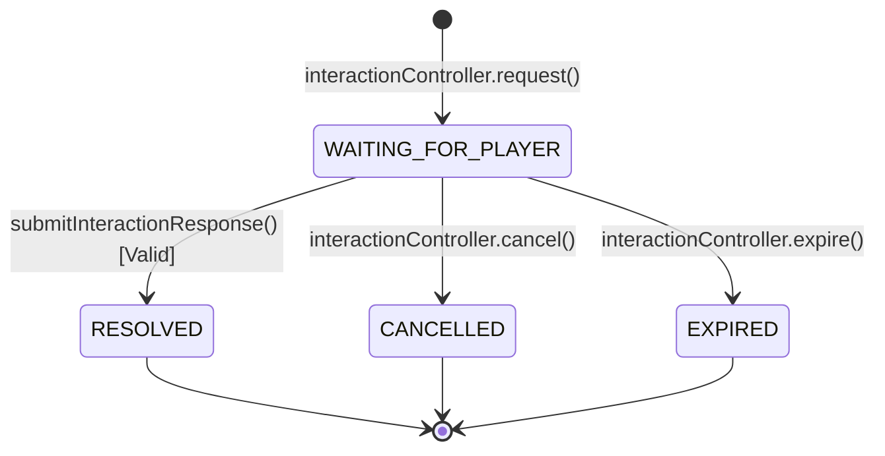

# Formal Interaction Protocol Documentation — Battle Spirits Eternal

**Project:** Battle Spirits Eternal (BSP)  
**Workspace:** `C:\Users\namis\Downloads\BSP`  
**Module:** `engine/interaction.js`  
**Date:** 2026-11-21  

---

## 1. Architectural Overview

The Battle Spirits Eternal Interaction Protocol governs all asynchronous human-in-the-loop and AI decision points during match execution. It enforces strict separation between:
1. **Rule Engine & Effect Resolution:** Pure, deterministic state progression that pauses when an ambiguous or optional decision must be made by a player.
2. **Interaction Broker:** Manages interaction lifecycle, request serialization, state persistence, response validation, and timeout/cancellation handling.
3. **Clients (UI / AI / Replay Runner):** Receives structured interaction payloads and submits discrete responses.

---

## 2. Interaction Schema Specification

Every interaction dispatched by the engine conforms to the canonical `InteractionRequest` schema:

```typescript
interface InteractionCandidate {
  candidateId: string;
  cardId?: string;
  name?: string;
  zone?: string;
  cost?: number;
  bp?: number;
  metadata?: Record<string, any>;
}

interface InteractionRequest {
  id: string;                      // Unique ID (e.g. "interaction_1732158900000_1")
  type: InteractionType;           // Canonical interaction opcode
  player: 'player' | 'opponent';   // Target player expected to respond
  sourceCardId?: string;           // Physical instance triggering the effect
  sourceAbilityId?: string;        // Canonical ability ID (e.g. "BS44-012#AB_1")
  candidates: InteractionCandidate[]; // Legal choices available to the player
  minSelections: number;           // Minimum required selections
  maxSelections: number;           // Maximum allowed selections
  optional: boolean;               // If true, selecting 0 is legal (decline effect)
  title?: string;                  // User-facing display prompt title
  message?: string;                // User-facing description
  context?: Record<string, any>;   // Additional rules context (step, phase, etc.)
  status: InteractionStatus;       // 'WAITING_FOR_PLAYER' | 'RESOLVED' | 'CANCELLED' | 'EXPIRED'
  createdAt: number;               // Timestamp in ms
}
```

---

## 3. Interaction Types (`INTERACTION_TYPES`)

The engine classifies all gameplay decisions into 9 canonical types:

| Type | Description | Typical Use Case |
|------|-------------|------------------|
| `SELECT_CARDS` | Select one or more cards from a specified candidate set | Targeting spirits for destruction, selecting cards to discard |
| `SELECT_TARGET` | Select an attack target or block target | Specifying which spirit or player to declare an attack against |
| `CHOOSE_OPTION` | Choose one branch from a modal effect | "Choose one: Draw 2 cards OR Destroy 1 BP 5000 spirit" |
| `PAY_CORES` | Choose source locations to pay cores from | Relocating cores from Reserve or Spirits to Trash to pay cost |
| `CHOOSE_CORES` | Choose number of cores to relocate or remove | Removing 2 cores from target spirit to send to Reserve |
| `SELECT_ZONE` | Select a destination or source zone | Choosing whether to place a card on top or bottom of deck |
| `SELECT_CARD` | Single card selection | Selecting 1 card revealed from top of deck to add to hand |
| `CONFIRM_ACTION` | Boolean confirmation | Optional effects: "You may destroy 1 spirit. Do so?" |
| `CHOOSE_EFFECT_ORDER` | Determine simultaneous trigger resolution order | Resolving 2 or more "When Summoned" effects |

---

## 4. Lifecycle & State Machine



### Lifecycle Steps:
1. **Request Creation:**
   - The effect resolver calls `interactionController.request(spec)`.
   - The interaction is registered in `this.activeInteractions` and added to `state.pendingInteractions`.
   - The engine emits the event `INTERACTION_REQUESTED` across the EventBus.
   - The resolver pauses on a returned Promise awaiting resolution.
2. **State Persistence:**
   - Because `pendingInteractions` is saved directly on `game.state`, game states can be snapshotted, saved to disk, or synchronized across network sessions without losing outstanding decision points.
3. **Response Submission & Validation:**
   - The UI or AI calls `game.submitInteractionResponse(interactionId, response)`.
   - `validateInteractionResponse` checks:
     - Is the interaction still active? If already resolved, returns `{ success: false, error: 'ALREADY_RESOLVED_OR_STALE' }`.
     - Did the player decline an optional effect (`accepted === false` or `selected: []`)?
     - If mandatory or accepted, are the selections within `[minSelections, maxSelections]` bounds?
     - Are all selected candidate IDs members of the original `candidates` array?
4. **Resolution:**
   - The pending Promise resolves with the validated selection payload.
   - The interaction status transitions to `RESOLVED`.
   - The interaction is moved to `this.resolvedInteractions` and purged from `state.pendingInteractions`.
   - The engine emits `INTERACTION_RESOLVED` and continues the game flow.

---

## 5. Security & Replay Attack Protection

A common vulnerability in web-based card games is replay/duplicate response submission (e.g. double-clicking an OK button or sending repeated network packets).

The `InteractionController` prevents replay attacks by retaining resolved interaction IDs in a bounded cache (`this.resolvedInteractions`). Any subsequent call to `submitInteractionResponse` for an already-resolved interaction fails immediately with:
```json
{
  "success": false,
  "error": "ALREADY_RESOLVED_OR_STALE"
}
```
No secondary state mutation or duplicate promise resolution can occur.
