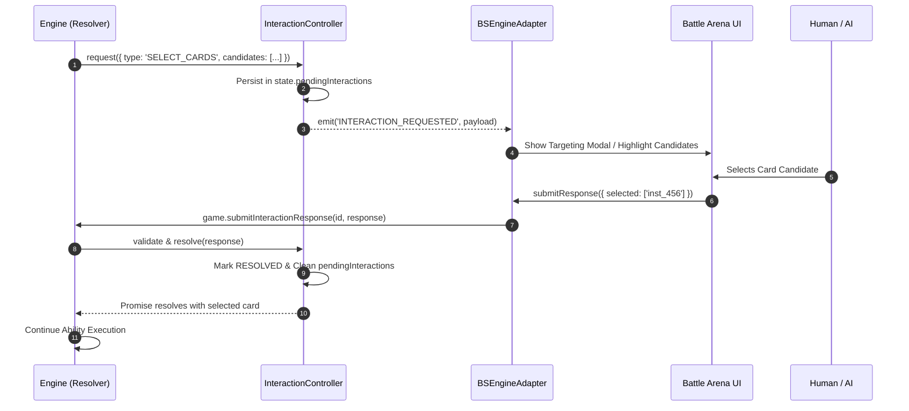

# Playable Game UI Integration Documentation

**Project:** Battle Spirits Eternal (BSP)  
**Workspace:** `C:\Users\namis\Downloads\BSP`  
**Components:** `engine_adapter.js`, `battle_arena.js`, `duel_session.js`  
**Date:** 2026-11-21  

---

## 1. Architectural Role of `engine_adapter.js`

`engine_adapter.js` serves as the official bi-directional bridge between the headless game engine (`engine/index.js`) and the browser-based graphical user interface (`battle_arena.js`, `src/ui/`, `duel_session.js`).

### Responsibilities:
1. **Engine Initialization:** Instantiates duel sessions with `strictRules: true`, setting up 40-card player and opponent decks, rules profiles, and event buses.
2. **Event Transformation:** Translates low-level engine events (`STEP_TRANSITION`, `CORE_MOVED`, `CARD_EXHAUSTED`, `CARD_BOUNCED`, `INTERACTION_REQUESTED`) into UI state notifications.
3. **Modal & Prompt Dispatch:** Catches `INTERACTION_REQUESTED` from the engine's `InteractionController` and presents interactive modals or targeting overlays to the active player.
4. **Action Dispatch:** Accepts user inputs (drag-and-drop card play, attack target clicks, modal selections) and calls engine APIs (`game.playCard`, `game.declareAttack`, `game.submitInteractionResponse`).

---

## 2. Interaction Integration Flow

---

## 3. Automated Testing & AI Fallback Mode

To support automated integration testing (such as `tests/ui_engine_integration.test.js`) and AI vs Human local duels:
- When a duel session is running in automated mode, the adapter registers an `AIDecider` or auto-resolver on the `promptManager` / `interactionController`.
- If an interaction arrives for an AI player, the adapter evaluates the candidate pool, selects the highest-value legal target according to the AI strategy heuristics, and calls `submitInteractionResponse` without stalling the turn.
- The UI listens reactively to `stateChanged` and re-renders the DOM, keeping the visual board in lockstep with internal engine state.
