# BATTLE SPIRITS ETERNAL — PHASE 3B
## Effect Family Dependency Graph

**Audit Date:** 2026-11-21  
**Project Root:** `C:\Users\namis\Downloads\BSP`

---

### 1. Inter-Family Dependency Diagram

```mermaid
flowchart TD
    subgraph CoreFoundation["Foundational Infrastructure (Phase 3C)"]
        DEP_STATE["State & Zone Engine (DEP-06, DEP-07)"]
        DEP_RESTRICT["Restrictions & Stage 4 Commit (DEP-14)"]
        DEP_COND["Condition Evaluator (DEP-02)"]
        DEP_SELECT["Selectors & Targeting (DEP-01, DEP-03)"]
        DEP_INTERACT["Interaction Protocol (DEP-04)"]
        DEP_PAY["Payment & Cost Calculus (DEP-05)"]
        DEP_SBA["State-Based Actions (DEP-16)"]
        DEP_CONT["Continuous Layer (DEP-08, DEP-09, DEP-12)"]
    end

    subgraph Wave1["Wave 1: Combat & Physical Cards (Phase 3D)"]
        FAM_CARD["Card and Zone Operations"]
        FAM_BP["BP and Combat Operations"]
    end

    subgraph Wave2["Wave 2: Resources & Information (Phase 3D)"]
        FAM_CORE["Core and Resource Operations"]
        FAM_DECK["Deck and Hand Operations"]
    end

    subgraph Wave3["Wave 3: Decisions & Rules (Phase 3D)"]
        FAM_TARGET["Targeting and Decision Operations"]
        FAM_RESTRICT_OPS["Conditions and Restrictions Ops"]
        FAM_CONT_OPS["Continuous, Timing & Trigger Ops"]
    end

    subgraph Wave4["Wave 4: Advanced Mechanics (Phase 3D)"]
        FAM_KEYWORD["Keyword Abilities"]
        FAM_SPEC["Specialized Mechanics (Advent/Mirage/Burst)"]
        FAM_SYS["System and Attribute Operations"]
    end

    DEP_STATE --> FAM_CARD
    DEP_SELECT --> FAM_CARD
    DEP_SBA --> FAM_CARD

    DEP_CONT --> FAM_BP
    DEP_SELECT --> FAM_BP
    DEP_SBA --> FAM_BP

    DEP_STATE --> FAM_CORE
    DEP_PAY --> FAM_CORE
    DEP_SBA --> FAM_CORE

    DEP_STATE --> FAM_DECK
    DEP_INTERACT --> FAM_DECK

    DEP_SELECT --> FAM_TARGET
    DEP_INTERACT --> FAM_TARGET

    DEP_RESTRICT --> FAM_RESTRICT_OPS
    DEP_COND --> FAM_RESTRICT_OPS

    DEP_CONT --> FAM_CONT_OPS

    FAM_BP --> FAM_KEYWORD
    FAM_CARD --> FAM_SPEC
    FAM_CORE --> FAM_SPEC
    DEP_PAY --> FAM_SPEC
    FAM_SPEC --> FAM_SYS
```

---

### 2. Implementation Precedence & Scheduling Matrix

| Implementation Wave | Target Effect Families | Core Shared Dependencies | Rationale |
| :--- | :--- | :--- | :--- |
| **Phase 3C** | Shared Engine Primitives | DEP-01 through DEP-17 | Completes atomic cost rollback, replacement arbitration, and duration clocks before operation expansions. |
| **Phase 3D: Wave 1** | Card & Zone, BP & Combat | DEP-01, DEP-06, DEP-07, DEP-08, DEP-16 | Solves core gameplay interactions: summoning, destruction, bounce, combat, and BP recalculation. |
| **Phase 3D: Wave 2** | Core & Resource, Deck & Hand | DEP-04, DEP-05, DEP-06, DEP-07, DEP-15 | Establishes resource flow, core management, drawing, milling, and searching. |
| **Phase 3D: Wave 3** | Targeting & Decision, Restrictions, Continuous | DEP-02, DEP-04, DEP-09, DEP-11, DEP-14 | Hardens multi-target choices, continuous rules, and once-per-turn restrictions. |
| **Phase 3D: Wave 4** | Specialized Mechanics, Keywords, System | Wave 1–3 Foundations + `engine/prerequisites.js` | Delivers Advent, Mirage, Burst triggers, and Grandwalker Nexus mechanics on a verified foundation. |
