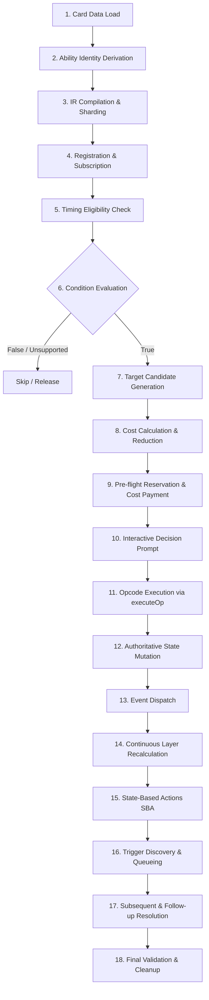

# BATTLE SPIRITS ETERNAL — PHASE 3B
## Effect Resolution Lifecycle: Authoritative 18-Step Specification

**Document Version:** 1.0.0  
**Authority:** `engine/resolver.js`, `engine/index.js`, `engine/rules/eternal.js`

---

### Lifecycle Flowchart

---

### Detailed Step-by-Step Contract

#### Step 1: Card Data Loading
- **Primary Engine Module:** `engine/state.js, data/ir_shards/`
- **Specification:** Authoritative card definition loaded from canonical cards_detailed.json or pre-compiled IR shard in data/ir_shards/.
- **Authoritative Invariants:** Card number is canonical key; card schema validated against ETERNAL_RULES.

#### Step 2: Ability Identity Derivation
- **Primary Engine Module:** `compiler/identity.js`
- **Specification:** Derives dual RFC 8785 ability identities: Physical ID (unique per card instance) and Semantic ID (reprint-invariant).
- **Authoritative Invariants:** Physical ID used for runtime activation; Semantic ID used for same-name activation restrictions.

#### Step 3: IR Compilation & Sharding
- **Primary Engine Module:** `compiler/index.js, compiler/clause_splitter.js`
- **Specification:** Ability text parsed into structured clauses, assigning opcodes, parameters, conditions, and grammar links.
- **Authoritative Invariants:** Preserves clause grammar links (then, byDoing, or, instead, afterResolves); zero ad-hoc regex in engine flow.

#### Step 4: Ability Registration & Subscription
- **Primary Engine Module:** `engine/index.js, engine/triggers.js`
- **Specification:** Triggered abilities subscribe to EventBus events (SUMMONED, ATTACK_DECLARED, DESTROYED, etc.).
- **Authoritative Invariants:** Voluntary activations (Main/Flash) registered on field stack tops; continuous abilities registered in modifier registry.

#### Step 5: Timing Eligibility Verification
- **Primary Engine Module:** `engine/flow.js, engine/windows.js, engine/prerequisites.js`
- **Specification:** Validates that current game step/phase matches ability header timing (MAIN, FLASH, WHEN_SUMMONED, etc.).
- **Authoritative Invariants:** Prefix prerequisites ([During Set], [During Burst], [During Advent]) evaluated; Turn 1 attack skip enforced.

#### Step 6: Condition Evaluation
- **Primary Engine Module:** `engine/conditions.js, engine/resolver.js`
- **Specification:** Evaluates structured conditions against state (4-state: TRUE, FALSE, UNSUPPORTED, INVALID_CONTEXT).
- **Authoritative Invariants:** Unmet conditions fail-fast without consuming activation budget or core resources; unsupported conditions fail safely.

#### Step 7: Target Candidate Generation & Filtering
- **Primary Engine Module:** `engine/selectors.js, engine/continuous.js`
- **Specification:** Queries legal targets from specified zones, filtering by types, colors, costs, BP, and protection immunity.
- **Authoritative Invariants:** Armor, Heavy Armor, and specific immunities evaluated before candidate presentation.

#### Step 8: Cost Calculation & Reduction
- **Primary Engine Module:** `engine/payment.js, engine/continuous.js`
- **Specification:** Calculates base cost, counts reduction symbols on field stacks, and computes effective payment requirement.
- **Authoritative Invariants:** Reduction cannot exceed maximum symbols; Soul Core reduction evaluated if applicable.

#### Step 9: Pre-flight Reservation & Cost Payment
- **Primary Engine Module:** `engine/restrictions.js, engine/payment.js, engine/zones.js`
- **Specification:** Synchronously reserves once-per-turn activation capacity; pays required cores/discards.
- **Authoritative Invariants:** Two-phase reservation: capacity reserved before async prompts; released if cost payment fails.

#### Step 10: Interactive Decision Prompt
- **Primary Engine Module:** `engine/interaction.js, engine/prompt_manager.js`
- **Specification:** If player choice required (targets, branches, optional confirmation), dispatches Promise-based prompt.
- **Authoritative Invariants:** Game engine pauses; UI or AI decider submits response via interaction protocol; invalid inputs rejected.

#### Step 11: Effect Execution via Opcode Dispatch
- **Primary Engine Module:** `engine/ops/index.js, engine/resolver.js`
- **Specification:** Dispatches operation to registered handler in engine/ops/index.js with full AbilityContext.
- **Authoritative Invariants:** Stage 4 Atomic Commit executed upon successful targeting/cost payment before state mutation.

#### Step 12: Authoritative State Mutation
- **Primary Engine Module:** `engine/state.js, engine/zones.js`
- **Specification:** Mutates game state (zone arrays, core counts, life values, exhaustion states, counters).
- **Authoritative Invariants:** Total system cores conserved; card identity preserved across zone transitions.

#### Step 13: Event Dispatch
- **Primary Engine Module:** `engine/events.js`
- **Specification:** Emits structured event to EventBus with complete context (cause, player, card, count, zones).
- **Authoritative Invariants:** Events are deterministic and contain full payload required for downstream triggers.

#### Step 14: Continuous-Effect Recalculation
- **Primary Engine Module:** `engine/continuous.js`
- **Specification:** Recalculates effective BP, levels, symbols, and active keywords across all field stacks.
- **Authoritative Invariants:** Layered modifier recalculation evaluated synchronously after state mutations.

#### Step 15: State-Based Actions (SBA) Check
- **Primary Engine Module:** `engine/sba.js`
- **Specification:** Applies automatic rules: 0-core spirits sent to trash, 0-BP spirits destroyed, 0-life player defeated.
- **Authoritative Invariants:** SBA runs in a loop until state reaches complete stability (stabilizeGameState).

#### Step 16: Trigger Discovery & Queueing
- **Primary Engine Module:** `engine/triggers.js`
- **Specification:** Discovers new triggers generated by emitted events and enqueues them in TriggerQueueManager.
- **Authoritative Invariants:** Active player triggers ordered before opposing player triggers; simultaneous triggers ordered by owner.

#### Step 17: Subsequent & Follow-up Resolution
- **Primary Engine Module:** `engine/resolver.js`
- **Specification:** Resolves connected clauses (then, byDoing, or, instead) and deferred afterResolves clauses.
- **Authoritative Invariants:** Propagates targeting context (previousTarget, selectedTargets) to downstream clauses.

#### Step 18: Final Game-State Validation & Cleanup
- **Primary Engine Module:** `engine/resolver.js, engine/state.js`
- **Specification:** Pops resolution frame stack, releases uncommitted reservations, and validates state invariants.
- **Authoritative Invariants:** Resolution stack depth never exceeds 32; no orphaned reservations remain in state.

---

### Grammar Link Semantics
- **`then`**: Downstream clause resolves if and only if prior clause executed without fatal error.
- **`byDoing` / `ifYouDo` / `whenYouveDoneSo`**: Prerequisite link. Requires `previousResult.success === true` and `previousResult.paid === true`. If prior action depleted activating card below level requirement (Rule Manual 17.0), downstream clause aborts with `SOURCE_DEPLETED_OR_LEVELED_DOWN`.
- **`or`**: Player presented with `CHOOSE_OR_BRANCH` prompt. Only chosen branch resolves; other branch marked `OR_BRANCH_NOT_CHOSEN`.
- **`afterResolves`**: Deferred follow-up clauses executed after all main clauses conclude. Inherits final targeting context.
