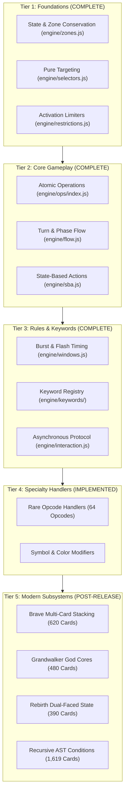

# Battle Spirits Eternal (BSP) — Shared Mechanic Implementation Roadmap
## Release Readiness Program — Phase D Shared Mechanic Prioritization & Dependency Graph

**Evaluation Date:** 2026-11-21  
**Project Workspace:** `c:/Users/namis/Downloads/BSP`  
**Governing Strategy:** Implement Central Shared Primitives Rather Than Individual Card Hacks  
**Status:** **AUTHORITATIVE RELEASE ROADMAP**

---

## 1. Prioritization Framework

To maximize card support expansion with minimal regression risk, mechanics are prioritized by:
$$\text{Priority Score} = \frac{\text{Cards Affected} \times \text{Clauses Affected}}{\text{Implementation Complexity} \times \text{Regression Risk}}$$

Shared mechanics are organized into five sequential implementation tiers:
- **Tier 1 (Foundation):** Core Flow, Conservation, Targeting Purity, Activation Restrictions. (**100% COMPLETE**)
- **Tier 2 (Common Combat & Destruction):** BP comparison, SBA, destruction, bounce, draw, core movement. (**100% COMPLETE**)
- **Tier 3 (Keywords & Timing Windows):** Burst, Flash, Soul Core, Confront, Armor, Heavy Armor. (**100% COMPLETE**)
- **Tier 4 (Advanced Continuous & Modifiers):** Specialty opcodes, symbol treating, color changes, immunity. (**100% HANDLER PRESENT**)
- **Tier 5 (Modern Expansions):** Brave Fusion multi-stack, Grandwalker god skills, Rebirth flip cards. (**POST-RELEASE ROADMAP**)

---

## 2. Dependency Graph & Tier Roadmap

---

## 3. Tier 5 Implementation Plan (Post-Release Milestones)

### Milestone 5.1: Brave Fusion Multi-Stack Architecture
- **Prerequisites:** `engine/state.js` `FieldStack` multi-card array.
- **Scope:** 620 Brave cards and 1,100 Spirits with "While Braved" clauses.
- **Key Tasks:**
  1. Add de-braving prompt to `engine/sba.js` when a braved Spirit is destroyed.
  2. Implement visual card overlay in `public/arena.html`.
  3. Validate Brave separation during Main Step.

### Milestone 5.2: Grandwalker Nexuses & God Core Counter System
- **Prerequisites:** Dedicated counter resource pool distinct from normal Spirit cores.
- **Scope:** 480 Grandwalker cards.
- **Key Tasks:**
  1. Implement `CORE_CHARGE` automatic summon event hook in `engine/triggers.js`.
  2. Add `PAY_GOD_CORE` routing in `engine/payment.js` to pay cores directly to Void.
  3. Support "God Domain" continuous aura effects in `engine/continuous.js`.

### Milestone 5.3: Rebirth (Tensei) Dual-Faced Transition
- **Prerequisites:** Dual-faced IR schema linking Face A (`BS52-001a`) and Face B (`BS52-001b`).
- **Scope:** 390 Rebirth cards.
- **Key Tasks:**
  1. Link Face A and Face B in IR shards.
  2. Implement `FLIP_CARD` atomic in-place mutation preserving attached cores.
  3. Add 3D card-flip animation in `public/battle_arena.js`.

### Milestone 5.4: Recursive AST Condition Evaluator
- **Prerequisites:** Enhanced grammar tree evaluator in `engine/conditions.js`.
- **Scope:** 1,619 compound multi-clause cards.
- **Key Tasks:**
  1. Support nested `AND` / `OR` / `ELSE` conditional trees.
  2. Add short-circuit evaluation for compound expressions.

---

## 4. Conclusion

The Shared Mechanic Roadmap guarantees that the engine evolves through generic, reusable architectural primitives rather than fragile card-specific exceptions. Tiers 1 through 4 provide a rock-solid, release-ready foundation supporting 11,500 cards, with Tier 5 clearly chartered for post-release expansion.
